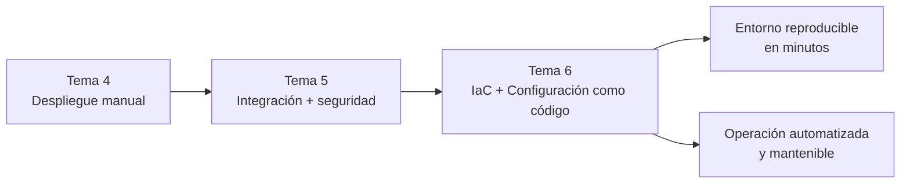
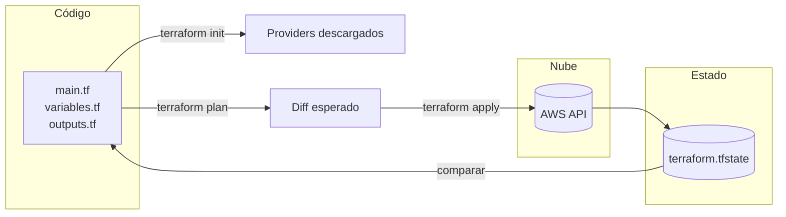
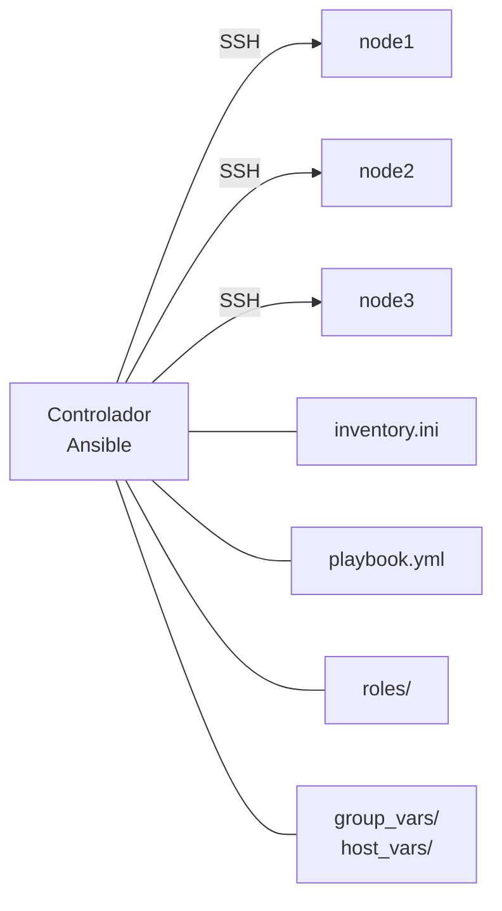
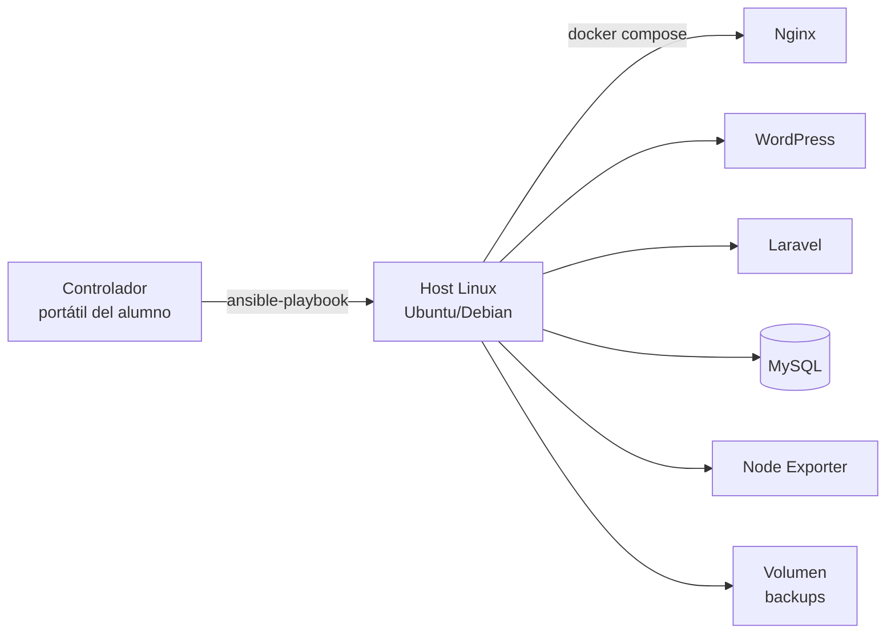
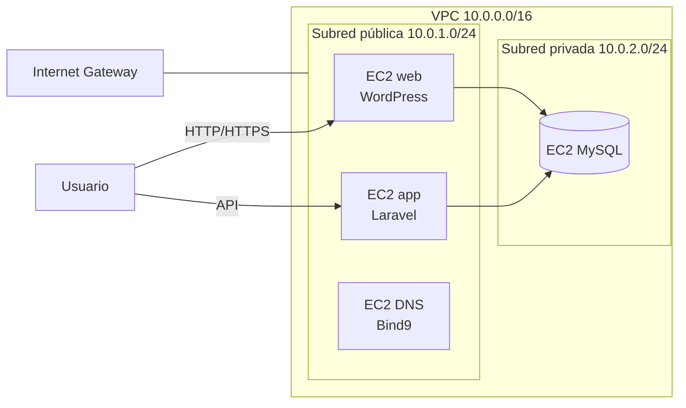
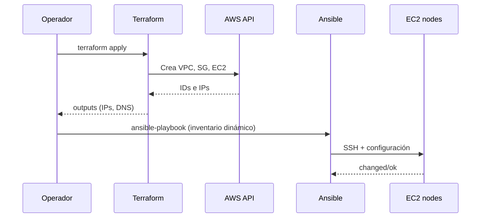

# 6. Despliegue y operación

> En esta unidad pasarás de un despliegue **funcional pero manual** a un despliegue **reproducible y operable** mediante **Infraestructura como Código (IaC)** con **Terraform** y **Gestión de Configuración** con **Ansible**.
>
> Trabajarás sobre los entornos reales que ya tienes desplegados en el Tema 5 (Docker o AWS) y los convertirás en **infraestructura versionada**, **playbooks idempotentes** y **operación automatizada**, siguiendo prácticas profesionales de DevOps.
>
> Hay **dos retos de igual alcance** (30p cada uno); cada grupo sigue **solo el que corresponda** a su línea de proyecto:
>
> - **RG601 (Ansible sobre Docker/Linux):** automatización del aprovisionamiento y configuración de servicios Linux (web, BBDD, backups, monitorización) sobre los hosts que sostienen el stack del Tema 5 (línea **Docker**).
> - **RG602 (Terraform + Ansible sobre AWS):** despliegue automático de la infraestructura AWS (VPC, EC2, SG, DNS Bind9, MySQL en EC2) con **Terraform** y configuración posterior con **Ansible**, sustituyendo el clic-clic en consola por código versionado.

Esta unidad de trabajo corresponde principalmente a los **Resultados de Aprendizaje RA3 y RA4**.

!!! tip "Idea clave del tema"
    Si en el Tema 5 conseguiste que todo **funcione**, en el Tema 6 debes conseguir que todo se pueda **volver a montar desde cero, sin tocar la consola, en pocos minutos y de forma idéntica** para cualquier integrante del equipo.

---

## Resultado de aprendizaje

Al finalizar esta unidad, serás capaz de:

- **RA3:** Validar, mediante automatización, que la solución es **reproducible y operable**, comprobando que un despliegue desde cero produce un entorno equivalente al ya validado en el Tema 5.
- **RA4:** **Documentar, versionar y desplegar** los manifiestos IaC (Terraform) y los playbooks (Ansible) en el repositorio del proyecto, con evidencias del flujo `init → plan → apply` y `ansible-playbook`.

---

## 1. De despliegue manual a despliegue como código

En el Tema 4 montaste el stack a mano y en el Tema 5 lo integraste y aseguraste. En el Tema 6 pasamos a un modelo **DevOps**: cada cambio en la infraestructura o en la configuración pasa por **un fichero versionado** en el repositorio.



### 1.1. ¿Por qué IaC y Configuration Management?

| Sin automatización | Con Terraform + Ansible |
|--------------------|--------------------------|
| Pasos manuales documentados en una wiki | Pasos en `*.tf` y `*.yml` versionados en Git |
| Dependencia de quien lo montó | Cualquier integrante puede ejecutar `apply` |
| "En mi máquina funciona" | Idempotencia: mismo resultado en cualquier host |
| Difícil reproducir errores | El error está en el código, se corrige y se vuelve a aplicar |
| Rollback complicado | `git revert` + nuevo `apply` |
| Auditoría imposible | Historial completo en Git |

### 1.2. Reparto de responsabilidades

| Herramienta | Para qué la usamos | Qué **no** hace |
|-------------|--------------------|-----------------|
| **Terraform** (HashiCorp) | Crear y destruir **infraestructura** (VPC, EC2, SG, Elastic IP, EBS, registros DNS) | Configurar el **dentro** de la máquina |
| **Ansible** (Red Hat) | Configurar lo que vive **dentro** de las máquinas: paquetes, ficheros, servicios, usuarios, *firewall* a nivel SO, despliegue de la app | Crear infraestructura cloud (aunque tiene módulos, lo dejamos a Terraform) |
| **Git + GitHub** | Versionar todo el código IaC, revisar cambios en Pull Request | Aplicar nada (lo aplica el operador o un *runner* CI/CD) |

!!! note "Regla práctica para ASIR"
    - **Terraform** para todo lo que **se crea/destruye** (recursos AWS, redes, hosts).
    - **Ansible** para todo lo que **se instala/configura** (paquetes, ficheros, servicios systemd, despliegue del código del proyecto).
    - **Docker Compose** del Tema 4/5 sigue siendo válido para describir la app, pero Ansible **lanza Compose** en lugar de tener que hacerlo a mano.

---

## 2. Conceptos básicos

### 2.1. Infraestructura como Código (IaC)

**Infraestructura como Código** consiste en describir la infraestructura mediante archivos de texto legibles por humanos y por máquinas, gestionados como código fuente (Git), aplicables de forma automática y **idempotente**.

- **Declarativo:** describes el **estado deseado** (Terraform, Ansible en modo declarativo). La herramienta calcula los pasos.
- **Imperativo:** describes **paso a paso** lo que hay que hacer (un script Bash o un *shell module* de Ansible).
- **Idempotencia:** aplicar la misma configuración **N veces** produce **el mismo resultado**, sin duplicar recursos.

### 2.2. Terraform en una pantalla



**Comandos esenciales:**

| Comando | Para qué sirve |
|---------|----------------|
| `terraform init` | Descarga *providers* y prepara el *backend*. Primera vez o tras cambios. |
| `terraform fmt` | Formatea el código (estilo HCL coherente). |
| `terraform validate` | Verifica sintaxis y referencias antes de tocar nada. |
| `terraform plan` | **Muestra** los cambios que aplicaría, sin tocar la infraestructura real. |
| `terraform apply` | Aplica los cambios al *provider* (pide confirmación). |
| `terraform destroy` | Elimina todos los recursos gestionados por ese estado. |
| `terraform output` | Muestra los valores de salida (IP pública, DNS, etc.). |

### 2.3. Ansible en una pantalla



**Elementos clave:**

| Elemento | Definición |
|----------|------------|
| **Controlador** | La máquina donde se ejecuta `ansible` y `ansible-playbook` (tu portátil o un *bastion*). |
| **Inventario** | Lista de hosts gestionados, agrupados (`[webservers]`, `[dbservers]`). Estático (`.ini` o `.yml`) o dinámico (script que consulta AWS, etc.). |
| **Playbook** | Fichero YAML con la secuencia de *plays* y *tasks* a aplicar. |
| **Módulo** | "Programa" de Ansible que ejecuta una acción concreta (`apt`, `copy`, `service`, `mysql_user`...). Hay cientos. |
| **Rol** | Estructura de carpetas reutilizable (`tasks/`, `handlers/`, `templates/`, `defaults/`, `vars/`, `files/`, `meta/`). Permite empaquetar lógica. |
| **Handler** | Tarea que se ejecuta **solo si otra la notifica** (típico para reiniciar servicios tras cambiar configuración). |
| **Variable** | Valor parametrizable (en `group_vars/`, `host_vars/`, defaults del rol, línea de comandos con `-e`...). |
| **Template** | Fichero Jinja2 (`.j2`) que se renderiza con variables antes de copiarse al host destino. |
| **Hecho (*fact*)** | Información que Ansible descubre del host (SO, IPs, RAM...) usable como variable. |

### 2.4. Idempotencia y `--check`

Una *task* idempotente devuelve **`changed=0`** cuando el estado del host ya coincide con el deseado. Para validarlo:

```bash
ansible-playbook -i inventario.ini site.yml --check --diff
```

- `--check`: simulación, **no aplica cambios**.
- `--diff`: muestra las diferencias línea a línea en los ficheros que se modificarían.

!!! warning "Regla de oro"
    Si tras ejecutar dos veces seguidas el mismo playbook obtienes `changed > 0` en la segunda ejecución, **tu playbook no es idempotente** y debe revisarse.

---

## 3. Retos de despliegue y operación

Cada grupo sigue **un** reto (el de su línea de proyecto). Ambos tienen guía detallada y **30 puntos**; el profesorado valora el reto que os corresponda.

| Aspecto | RG601 — Ansible sobre Docker/Linux | RG602 — Terraform + Ansible en AWS |
|---------|------------------------------------|------------------------------------|
| **Punto de partida** | Stack Compose del Tema 5 (Nginx, WordPress, Laravel, MySQL) ejecutándose en uno o varios hosts Linux | Infraestructura AWS del Tema 5 (VPC, EC2 web, EC2 app, EC2 MySQL, EC2 DNS Bind9) creada a mano |
| **Aprovisionamiento** | Ansible aprovisiona el host (paquetes, Docker, usuarios, *firewall*) y lanza Compose | Terraform crea VPC + subredes + SG + EC2 + EIP; Ansible las configura |
| **Configuración** | Roles Ansible: `common`, `docker_host`, `nginx_proxy`, `backups`, `monitoring` | Roles Ansible: `common`, `web`, `app`, `db`, `dns`, `hardening` |
| **Operación** | `ansible-playbook site.yml` reproduce el host completo desde cero | `terraform apply` + `ansible-playbook site.yml` reproducen infraestructura y configuración |
| **Seguridad** | SSH con claves, `ansible-vault` para secretos, UFW/firewalld, hardening básico | IAM mínimo, *state* protegido, `ansible-vault`, SG restrictivos, SSH endurecido |
| **Monitorización** | Node Exporter / Prometheus desplegado vía rol Ansible | CloudWatch Agent instalado por Ansible; alarmas básicas opcionalmente con Terraform |
| **Proyecto de referencia** | [Un proyecto de un curso anterior](https://elimpermeable.github.io/Proyecto_Intermodular2ASIR_IJJ/) | [Un proyecto de un curso anterior](https://alejandromarinyo.github.io/Proyecto-Intermodular/) |

---

## 4. RG601 — Aprovisionamiento y operación con Ansible (línea Docker)

> **Objetivo:** que cualquier integrante del grupo, partiendo de una máquina Linux recién instalada (Ubuntu Server 22.04 o Debian 12), pueda ejecutar **un solo comando** y obtener el stack del Tema 5 en marcha, idéntico al validado, **con backups y monitorización básica**.

### 4.1. Arquitectura objetivo



### 4.2. Estructura del repositorio Ansible

```text
ansible/
├── ansible.cfg
├── inventory/
│   ├── hosts.ini                # inventario estático
│   └── group_vars/
│       ├── all.yml              # variables comunes
│       └── webservers.yml       # variables específicas
├── site.yml                     # playbook principal
├── requirements.yml             # roles/colecciones externas
├── roles/
│   ├── common/
│   │   ├── tasks/main.yml
│   │   ├── handlers/main.yml
│   │   └── defaults/main.yml
│   ├── docker_host/
│   │   ├── tasks/main.yml
│   │   └── templates/daemon.json.j2
│   ├── stack_compose/
│   │   ├── tasks/main.yml
│   │   ├── templates/docker-compose.yml.j2
│   │   ├── templates/nginx.conf.j2
│   │   └── files/
│   ├── backups/
│   │   ├── tasks/main.yml
│   │   └── templates/backup.sh.j2
│   └── monitoring/
│       ├── tasks/main.yml
│       └── templates/prometheus.yml.j2
└── vault/
    └── secrets.yml              # cifrado con ansible-vault
```

### 4.3. Ficheros base

**`ansible.cfg`**

```ini
[defaults]
inventory       = inventory/hosts.ini
roles_path      = roles
host_key_checking = False
retry_files_enabled = False
stdout_callback = yaml
forks           = 10
interpreter_python = auto_silent

[ssh_connection]
pipelining = True
```

**`inventory/hosts.ini`**

```ini
[webservers]
web01 ansible_host=192.168.1.50 ansible_user=ubuntu

[dbservers]
db01  ansible_host=192.168.1.51 ansible_user=ubuntu

[monitoring]
mon01 ansible_host=192.168.1.52 ansible_user=ubuntu

[all:vars]
ansible_ssh_private_key_file=~/.ssh/asir_pi
```

**`inventory/group_vars/all.yml`**

```yaml
---
proyecto: "intermodular-asir"
zona_horaria: "Europe/Madrid"
usuarios_admin:
  - { nombre: "alumno1", clave_publica: "ssh-ed25519 AAAA... alumno1@asir" }
  - { nombre: "alumno2", clave_publica: "ssh-ed25519 AAAA... alumno2@asir" }

paquetes_base:
  - curl
  - git
  - ufw
  - htop
  - vim
  - python3-pip
```

**`site.yml`**

```yaml
---
- name: Aprovisionamiento del host del proyecto (RG601)
  hosts: webservers
  become: true
  roles:
    - role: common
    - role: docker_host
    - role: stack_compose
    - role: backups
    - role: monitoring
```

### 4.4. Rol `common` (paquetes, usuarios, *firewall*)

**`roles/common/tasks/main.yml`**

```yaml
---
- name: Configurar zona horaria
  community.general.timezone:
    name: "{{ zona_horaria }}"

- name: Actualizar caché de paquetes (Debian/Ubuntu)
  ansible.builtin.apt:
    update_cache: true
    cache_valid_time: 3600

- name: Instalar paquetes base
  ansible.builtin.apt:
    name: "{{ paquetes_base }}"
    state: present

- name: Crear usuarios de administración
  ansible.builtin.user:
    name: "{{ item.nombre }}"
    groups: sudo
    shell: /bin/bash
    state: present
  loop: "{{ usuarios_admin }}"

- name: Instalar claves SSH
  ansible.posix.authorized_key:
    user: "{{ item.nombre }}"
    key: "{{ item.clave_publica }}"
    state: present
  loop: "{{ usuarios_admin }}"

- name: Permitir SSH en UFW
  community.general.ufw:
    rule: allow
    port: "22"
    proto: tcp

- name: Habilitar UFW por defecto deny
  community.general.ufw:
    state: enabled
    policy: deny
```

### 4.5. Rol `docker_host`

**`roles/docker_host/tasks/main.yml`**

```yaml
---
- name: Instalar dependencias para repositorio Docker
  ansible.builtin.apt:
    name:
      - ca-certificates
      - gnupg
      - lsb-release
    state: present

- name: Añadir clave GPG oficial de Docker
  ansible.builtin.apt_key:
    url: https://download.docker.com/linux/ubuntu/gpg
    state: present

- name: Añadir repositorio Docker
  ansible.builtin.apt_repository:
    repo: "deb [arch=amd64] https://download.docker.com/linux/ubuntu {{ ansible_distribution_release }} stable"
    state: present
    filename: docker

- name: Instalar Docker Engine y Compose plugin
  ansible.builtin.apt:
    name:
      - docker-ce
      - docker-ce-cli
      - containerd.io
      - docker-compose-plugin
    state: present
    update_cache: true

- name: Añadir usuarios admin al grupo docker
  ansible.builtin.user:
    name: "{{ item.nombre }}"
    groups: docker
    append: true
  loop: "{{ usuarios_admin }}"

- name: Asegurar servicio Docker
  ansible.builtin.service:
    name: docker
    state: started
    enabled: true
```

### 4.6. Rol `stack_compose` con plantilla Jinja2

**`roles/stack_compose/defaults/main.yml`**

```yaml
---
stack_dir: /opt/proyecto
mysql_db: wordpress
mysql_user: wp_user
puertos:
  http: 80
  https: 443
```

**`roles/stack_compose/tasks/main.yml`**

```yaml
---
- name: Crear directorio del stack
  ansible.builtin.file:
    path: "{{ stack_dir }}"
    state: directory
    mode: "0750"

- name: Desplegar docker-compose.yml desde plantilla
  ansible.builtin.template:
    src: docker-compose.yml.j2
    dest: "{{ stack_dir }}/docker-compose.yml"
    mode: "0640"
  notify: Recrear stack

- name: Desplegar configuración Nginx
  ansible.builtin.template:
    src: nginx.conf.j2
    dest: "{{ stack_dir }}/nginx.conf"
    mode: "0644"
  notify: Recrear stack

- name: Arrancar el stack
  community.docker.docker_compose_v2:
    project_src: "{{ stack_dir }}"
    state: present
```

**`roles/stack_compose/handlers/main.yml`**

```yaml
---
- name: Recrear stack
  community.docker.docker_compose_v2:
    project_src: "{{ stack_dir }}"
    state: present
    recreate: always
```

**`roles/stack_compose/templates/docker-compose.yml.j2`**

```yaml
services:
  nginx:
    image: nginx:1.27
    ports:
      - "{{ puertos.http }}:80"
      - "{{ puertos.https }}:443"
    volumes:
      - ./nginx.conf:/etc/nginx/conf.d/default.conf:ro
    depends_on:
      - wordpress

  wordpress:
    image: wordpress:php8.2-fpm
    environment:
      WORDPRESS_DB_HOST: db
      WORDPRESS_DB_USER: "{{ mysql_user }}"
      WORDPRESS_DB_PASSWORD: "{{ vault_mysql_password }}"
      WORDPRESS_DB_NAME: "{{ mysql_db }}"

  db:
    image: mysql:8.0
    environment:
      MYSQL_DATABASE: "{{ mysql_db }}"
      MYSQL_USER: "{{ mysql_user }}"
      MYSQL_PASSWORD: "{{ vault_mysql_password }}"
      MYSQL_ROOT_PASSWORD: "{{ vault_mysql_root_password }}"
    volumes:
      - dbdata:/var/lib/mysql

volumes:
  dbdata:
```

### 4.7. Secretos con `ansible-vault`

Nunca se suben contraseñas en claro a Git. Crea un fichero cifrado:

```bash
ansible-vault create vault/secrets.yml
```

Contenido (se edita en claro, se guarda cifrado):

```yaml
vault_mysql_password: "P4ssw0rd_segura_para_wp"
vault_mysql_root_password: "Otra_clave_muy_robusta"
```

Ejecución pidiendo la *vault password*:

```bash
ansible-playbook -i inventory/hosts.ini site.yml \
  --extra-vars "@vault/secrets.yml" --ask-vault-pass
```

!!! warning "No commitees claves en claro"
    Añade a `.gitignore` cualquier fichero `*.pem`, `*.key`, `.env` real y nunca subas la *vault password*. En GitHub puedes guardarla como **secret** del repositorio si usas GitHub Actions.

### 4.8. Rol `backups`

**`roles/backups/tasks/main.yml`**

```yaml
---
- name: Crear directorio de backups
  ansible.builtin.file:
    path: /var/backups/proyecto
    state: directory
    mode: "0750"

- name: Desplegar script de backup
  ansible.builtin.template:
    src: backup.sh.j2
    dest: /usr/local/bin/backup-proyecto.sh
    mode: "0750"

- name: Programar cron diario a las 03:00
  ansible.builtin.cron:
    name: "Backup MySQL proyecto"
    minute: "0"
    hour: "3"
    job: "/usr/local/bin/backup-proyecto.sh >> /var/log/backup-proyecto.log 2>&1"
```

**`roles/backups/templates/backup.sh.j2`**

```bash
#!/usr/bin/env bash
set -euo pipefail

FECHA=$(date +%Y%m%d_%H%M)
DEST=/var/backups/proyecto
cd {{ stack_dir }}

docker compose exec -T db \
  mysqldump -u root -p"{{ vault_mysql_root_password }}" \
  --single-transaction --routines --triggers \
  {{ mysql_db }} | gzip > "$DEST/${FECHA}_{{ mysql_db }}.sql.gz"

find "$DEST" -name '*.sql.gz' -mtime +7 -delete
```

### 4.9. Rol `monitoring` (Node Exporter + Prometheus mínimo)

**`roles/monitoring/tasks/main.yml`**

```yaml
---
- name: Desplegar Node Exporter como contenedor
  community.docker.docker_container:
    name: node-exporter
    image: prom/node-exporter:latest
    restart_policy: unless-stopped
    network_mode: host
    pid_mode: host
    volumes:
      - /proc:/host/proc:ro
      - /sys:/host/sys:ro
      - /:/rootfs:ro
    command:
      - '--path.procfs=/host/proc'
      - '--path.sysfs=/host/sys'
      - '--path.rootfs=/rootfs'

- name: Permitir Prometheus scrape en UFW
  community.general.ufw:
    rule: allow
    port: "9100"
    proto: tcp
    src: "{{ prometheus_cidr | default('192.168.1.0/24') }}"
```

### 4.10. Ejecución y validación

```bash
cd ansible/
ansible-playbook -i inventory/hosts.ini site.yml --check --diff   # simulación
ansible-playbook -i inventory/hosts.ini site.yml --ask-vault-pass # aplicar
ansible-playbook -i inventory/hosts.ini site.yml --ask-vault-pass # 2.ª vez: changed=0
```

**Criterios de aceptación de RG601**

- [ ] El primer `apply` deja el stack funcional (HTTP 200 en `/`).
- [ ] El segundo `apply` no realiza cambios (idempotencia verificada).
- [ ] El backup se ejecuta y deja `.sql.gz` en `/var/backups/proyecto`.
- [ ] Existen al menos **dos roles** propios distintos a los de ejemplo.
- [ ] Los secretos están cifrados con `ansible-vault`.
- [ ] `node_exporter` responde en el puerto `9100` solo desde la red autorizada.

---

## 5. RG602 — Terraform + Ansible en AWS (línea cloud)

> **Objetivo:** sustituir el clic-clic en la consola AWS por **código Terraform** que crea VPC, subredes, SG y EC2; y un **playbook Ansible** que configura las EC2 (web, app, MySQL, DNS) con la misma topología validada en el Tema 5.

### 5.1. Arquitectura objetivo



### 5.2. Estructura del repositorio

```text
deploy/
├── terraform/
│   ├── main.tf
│   ├── variables.tf
│   ├── outputs.tf
│   ├── providers.tf
│   ├── network.tf
│   ├── compute.tf
│   ├── security.tf
│   └── terraform.tfvars.example
├── ansible/
│   ├── ansible.cfg
│   ├── inventory_aws_ec2.yml      # inventario dinámico
│   ├── site.yml
│   ├── group_vars/
│   │   └── all.yml
│   └── roles/
│       ├── common/
│       ├── web/
│       ├── app/
│       ├── db/
│       ├── dns/
│       └── hardening/
└── README.md
```

### 5.3. Terraform: providers y red

**`terraform/providers.tf`**

```hcl
terraform {
  required_version = ">= 1.6"
  required_providers {
    aws = {
      source  = "hashicorp/aws"
      version = "~> 5.0"
    }
  }
}

provider "aws" {
  region = var.region
}
```

**`terraform/variables.tf`**

```hcl
variable "region"           { type = string  default = "us-east-1" }
variable "project"          { type = string  default = "pi-asir" }
variable "key_name"         { type = string }
variable "admin_ip_cidr"    { type = string  description = "IP del aula con /32" }
variable "ami_ubuntu"       { type = string  default = "ami-0a0e5d9c7acc336f1" }
variable "instance_type"    { type = string  default = "t3.micro" }
```

**`terraform/network.tf`**

```hcl
resource "aws_vpc" "main" {
  cidr_block           = "10.0.0.0/16"
  enable_dns_hostnames = true
  tags = { Name = "${var.project}-vpc" }
}

resource "aws_internet_gateway" "igw" {
  vpc_id = aws_vpc.main.id
  tags   = { Name = "${var.project}-igw" }
}

resource "aws_subnet" "public" {
  vpc_id                  = aws_vpc.main.id
  cidr_block              = "10.0.1.0/24"
  map_public_ip_on_launch = true
  availability_zone       = "${var.region}a"
  tags                    = { Name = "${var.project}-public" }
}

resource "aws_subnet" "private" {
  vpc_id            = aws_vpc.main.id
  cidr_block        = "10.0.2.0/24"
  availability_zone = "${var.region}b"
  tags              = { Name = "${var.project}-private" }
}

resource "aws_route_table" "public" {
  vpc_id = aws_vpc.main.id
  route {
    cidr_block = "0.0.0.0/0"
    gateway_id = aws_internet_gateway.igw.id
  }
  tags = { Name = "${var.project}-rt-public" }
}

resource "aws_route_table_association" "public" {
  subnet_id      = aws_subnet.public.id
  route_table_id = aws_route_table.public.id
}
```

### 5.4. Terraform: Security Groups y EC2

**`terraform/security.tf`**

```hcl
resource "aws_security_group" "web" {
  name        = "${var.project}-sg-web"
  description = "HTTP/HTTPS público + SSH del aula"
  vpc_id      = aws_vpc.main.id

  ingress { from_port = 80  to_port = 80  protocol = "tcp" cidr_blocks = ["0.0.0.0/0"] }
  ingress { from_port = 443 to_port = 443 protocol = "tcp" cidr_blocks = ["0.0.0.0/0"] }
  ingress { from_port = 22  to_port = 22  protocol = "tcp" cidr_blocks = [var.admin_ip_cidr] }

  egress  { from_port = 0   to_port = 0   protocol = "-1"  cidr_blocks = ["0.0.0.0/0"] }
}

resource "aws_security_group" "db" {
  name   = "${var.project}-sg-db"
  vpc_id = aws_vpc.main.id

  ingress {
    from_port       = 3306
    to_port         = 3306
    protocol        = "tcp"
    security_groups = [aws_security_group.web.id]    # solo desde web
  }
  egress  { from_port = 0 to_port = 0 protocol = "-1" cidr_blocks = ["0.0.0.0/0"] }
}

resource "aws_security_group" "dns" {
  name   = "${var.project}-sg-dns"
  vpc_id = aws_vpc.main.id

  ingress { from_port = 53 to_port = 53 protocol = "udp" cidr_blocks = ["0.0.0.0/0"] }
  ingress { from_port = 53 to_port = 53 protocol = "tcp" cidr_blocks = ["0.0.0.0/0"] }
  ingress { from_port = 22 to_port = 22 protocol = "tcp" cidr_blocks = [var.admin_ip_cidr] }
  egress  { from_port = 0  to_port = 0  protocol = "-1"  cidr_blocks = ["0.0.0.0/0"] }
}
```

**`terraform/compute.tf`**

```hcl
locals {
  hosts = {
    web = { subnet = aws_subnet.public.id,  sg = aws_security_group.web.id }
    app = { subnet = aws_subnet.public.id,  sg = aws_security_group.web.id }
    db  = { subnet = aws_subnet.private.id, sg = aws_security_group.db.id  }
    dns = { subnet = aws_subnet.public.id,  sg = aws_security_group.dns.id }
  }
}

resource "aws_instance" "node" {
  for_each                    = local.hosts
  ami                         = var.ami_ubuntu
  instance_type               = var.instance_type
  subnet_id                   = each.value.subnet
  vpc_security_group_ids      = [each.value.sg]
  key_name                    = var.key_name
  associate_public_ip_address = each.key != "db"

  tags = {
    Name    = "${var.project}-${each.key}"
    Role    = each.key
    Project = var.project
  }
}

resource "aws_eip" "web" {
  instance = aws_instance.node["web"].id
  domain   = "vpc"
  tags     = { Name = "${var.project}-eip-web" }
}
```

**`terraform/outputs.tf`**

```hcl
output "ips_publicas" {
  value = { for k, v in aws_instance.node : k => v.public_ip if v.public_ip != "" }
}

output "ip_privada_db" {
  value = aws_instance.node["db"].private_ip
}

output "eip_web" { value = aws_eip.web.public_ip }
```

### 5.5. Flujo Terraform

```bash
cd deploy/terraform
cp terraform.tfvars.example terraform.tfvars   # edita con tus valores
terraform init
terraform fmt -recursive
terraform validate
terraform plan -out tfplan
terraform apply tfplan
terraform output -json > ../ansible/tf_outputs.json
```

!!! danger "No subas el `tfstate`"
    Añade a `.gitignore`:

    ```gitignore
    .terraform/
    *.tfstate
    *.tfstate.*
    terraform.tfvars
    crash.log
    ```

    En entornos colaborativos reales, configura un **backend remoto** (S3 + DynamoDB para *locking*). En el aula podemos trabajar con estado local **siempre que solo aplique una persona a la vez**.

### 5.6. Inventario dinámico de Ansible para AWS

**`ansible/inventory_aws_ec2.yml`**

```yaml
plugin: amazon.aws.aws_ec2
regions:
  - us-east-1
filters:
  tag:Project: pi-asir
keyed_groups:
  - key: tags.Role
    prefix: role
hostnames:
  - tag:Name
compose:
  ansible_host: public_ip_address | default(private_ip_address)
  ansible_user: "'ubuntu'"
```

Instalar la colección:

```bash
ansible-galaxy collection install amazon.aws community.general community.mysql ansible.posix
```

Probarlo:

```bash
ansible-inventory -i inventory_aws_ec2.yml --graph
```

Debería mostrarte grupos `role_web`, `role_app`, `role_db`, `role_dns`.

### 5.7. Playbook principal `site.yml`

```yaml
---
- name: Configuración base de todos los nodos
  hosts: all
  become: true
  roles:
    - common
    - hardening

- name: Servidor DNS Bind9
  hosts: role_dns
  become: true
  roles:
    - dns

- name: Base de datos MySQL
  hosts: role_db
  become: true
  roles:
    - db

- name: Servidor web WordPress
  hosts: role_web
  become: true
  roles:
    - web

- name: Aplicación Laravel
  hosts: role_app
  become: true
  roles:
    - app
```

### 5.8. Rol `dns` (Bind9)

**`roles/dns/tasks/main.yml`**

```yaml
---
- name: Instalar Bind9
  ansible.builtin.apt:
    name: [bind9, bind9utils, dnsutils]
    state: present
    update_cache: true

- name: Configurar zona directa
  ansible.builtin.template:
    src: db.proyecto.local.j2
    dest: /etc/bind/db.proyecto.local
    owner: bind
    group: bind
    mode: "0644"
  notify: Reiniciar bind9

- name: Declarar zona en named.conf.local
  ansible.builtin.template:
    src: named.conf.local.j2
    dest: /etc/bind/named.conf.local
    mode: "0644"
  notify: Reiniciar bind9

- name: Habilitar y arrancar bind9
  ansible.builtin.service:
    name: bind9
    state: started
    enabled: true
```

**`roles/dns/templates/db.proyecto.local.j2`**

```text
$TTL    604800
@   IN  SOA ns.proyecto.local. admin.proyecto.local. (
                {{ ansible_date_time.epoch }} ; Serial
                604800     ; Refresh
                86400      ; Retry
                2419200    ; Expire
                604800 )   ; Negative Cache TTL
;
@       IN  NS  ns.proyecto.local.
ns      IN  A   {{ hostvars[groups['role_dns'][0]]['ansible_host'] }}
web     IN  A   {{ hostvars[groups['role_web'][0]]['ansible_host'] }}
app     IN  A   {{ hostvars[groups['role_app'][0]]['ansible_host'] }}
db      IN  A   {{ hostvars[groups['role_db'][0]]['private_ip_address'] }}
```

### 5.9. Rol `db` (MySQL en EC2)

**`roles/db/tasks/main.yml`**

```yaml
---
- name: Instalar MySQL Server
  ansible.builtin.apt:
    name: [mysql-server, python3-pymysql]
    state: present
    update_cache: true

- name: Vincular MySQL a la IP privada
  ansible.builtin.lineinfile:
    path: /etc/mysql/mysql.conf.d/mysqld.cnf
    regexp: "^bind-address"
    line: "bind-address = {{ ansible_default_ipv4.address }}"
  notify: Reiniciar mysql

- name: Crear base de datos del proyecto
  community.mysql.mysql_db:
    name: "{{ db_nombre }}"
    state: present
    login_unix_socket: /var/run/mysqld/mysqld.sock

- name: Crear usuario aplicación
  community.mysql.mysql_user:
    name: "{{ db_usuario }}"
    password: "{{ vault_db_password }}"
    priv: "{{ db_nombre }}.*:ALL"
    host: "%"
    state: present
    login_unix_socket: /var/run/mysqld/mysqld.sock
```

### 5.10. Rol `hardening` (mínimos profesionales)

**`roles/hardening/tasks/main.yml`**

```yaml
---
- name: Deshabilitar acceso root por SSH
  ansible.builtin.lineinfile:
    path: /etc/ssh/sshd_config
    regexp: "^#?PermitRootLogin"
    line: "PermitRootLogin no"
  notify: Reiniciar sshd

- name: Deshabilitar contraseñas en SSH (solo clave pública)
  ansible.builtin.lineinfile:
    path: /etc/ssh/sshd_config
    regexp: "^#?PasswordAuthentication"
    line: "PasswordAuthentication no"
  notify: Reiniciar sshd

- name: Instalar fail2ban
  ansible.builtin.apt:
    name: fail2ban
    state: present

- name: Activar fail2ban
  ansible.builtin.service:
    name: fail2ban
    state: started
    enabled: true

- name: Aplicar actualizaciones automáticas de seguridad
  ansible.builtin.apt:
    name: unattended-upgrades
    state: present
```

### 5.11. Despliegue completo en un único comando

```bash
# 1. Infraestructura
cd deploy/terraform && terraform apply -auto-approve

# 2. Esperar a que SSH esté disponible (~60 s)
sleep 60

# 3. Configuración
cd ../ansible
ansible-playbook -i inventory_aws_ec2.yml site.yml --ask-vault-pass
```

**Criterios de aceptación de RG602**

- [ ] `terraform plan` no muestra cambios tras `apply` exitoso.
- [ ] El inventario dinámico detecta automáticamente las 4 EC2.
- [ ] `nslookup web.proyecto.local @<IP_DNS>` responde.
- [ ] Web y app conectan con MySQL en la subred privada.
- [ ] La regla SG bloquea `3306` desde cualquier IP que **no** sea `sg-web` (prueba negativa).
- [ ] El playbook es idempotente (segundo `apply` con `changed=0`).
- [ ] No hay claves ni `tfstate` en el repositorio Git.

---

## 6. Integración Terraform + Ansible

Hay dos formas habituales de unirlos:

### 6.1. Patrón "Terraform primero, Ansible después" (recomendado en el aula)



**Ventajas:** límites claros entre IaC e CM, fácil depuración, scope reducido.

### 6.2. Patrón "Terraform invoca Ansible"

Con el provisioner `local-exec`:

```hcl
resource "null_resource" "configure" {
  depends_on = [aws_instance.node]
  provisioner "local-exec" {
    command = "ansible-playbook -i inventory_aws_ec2.yml site.yml"
  }
}
```

Útil para pipelines CI/CD, pero acopla las herramientas. Se recomienda **solo** cuando el equipo ya tiene experiencia.

### 6.3. Patrón "user_data" para arranque mínimo

Terraform pasa un script Bash a la EC2 en su primer arranque para que se "auto-registre" o instale el agente Ansible/python:

```hcl
resource "aws_instance" "node" {
  # ...
  user_data = <<-EOF
    #!/bin/bash
    apt-get update
    apt-get install -y python3
  EOF
}
```

!!! tip "Buena práctica"
    Deja `user_data` con lo **estrictamente imprescindible** para que Ansible pueda conectar (python, claves). Todo lo demás, en playbooks; así mantienes la separación de responsabilidades.

---

## 7. Operación y mantenimiento

Una vez automatizado el despliegue, la **operación** es el día a día del sistema.

### 7.1. Tareas operativas típicas

| Tarea | Herramienta | Frecuencia |
|-------|-------------|------------|
| Aplicar parches de seguridad | `unattended-upgrades` + playbook `update.yml` | Semanal |
| Renovar certificados TLS | `certbot` desde Ansible | Mensual / automático |
| Comprobar backups | Script `verify-backup.sh` + cron | Diario |
| Rotación de logs | `logrotate` (configurado por Ansible) | Diario |
| Restauración en *staging* | `mysql < backup.sql` (probado periódicamente) | Mensual |
| Revisión de alarmas | CloudWatch / Prometheus | Continua |
| Inventario actualizado | `ansible-inventory --graph` | Antes de cada cambio |

### 7.2. Playbook de actualización segura

```yaml
---
- name: Actualizar paquetes con ventana de mantenimiento
  hosts: all
  become: true
  serial: 1                      # uno por uno, evita caídas simultáneas
  max_fail_percentage: 0
  tasks:
    - name: Actualizar caché
      ansible.builtin.apt:
        update_cache: true

    - name: Aplicar upgrades de seguridad
      ansible.builtin.apt:
        upgrade: dist
        autoremove: true
      register: upgrade_result

    - name: Reiniciar si lo pide el kernel
      ansible.builtin.reboot:
        msg: "Reinicio tras actualización del kernel"
      when: upgrade_result.changed
        and ansible_facts['kernel'] is defined
        and lookup('file', '/var/run/reboot-required', errors='ignore') is not none
```

### 7.3. Monitorización básica

| Stack | Componentes mínimos | Despliegue |
|-------|---------------------|------------|
| **Prometheus** | Node Exporter + Prometheus Server + Alertmanager | Compose + rol Ansible |
| **CloudWatch (AWS)** | CloudWatch Agent + alarmas (`CPUUtilization`, `StatusCheckFailed`) | Instalado por Ansible; alarmas opcionalmente con Terraform |
| **Pandora FMS** | Servidor + agentes en cada nodo | Rol Ansible que despliega el agente |

Ejemplo de alarma CloudWatch en Terraform:

```hcl
resource "aws_cloudwatch_metric_alarm" "cpu_web" {
  alarm_name          = "${var.project}-cpu-web"
  comparison_operator = "GreaterThanThreshold"
  evaluation_periods  = 2
  metric_name         = "CPUUtilization"
  namespace           = "AWS/EC2"
  period              = 300
  statistic           = "Average"
  threshold           = 80
  dimensions          = { InstanceId = aws_instance.node["web"].id }
  alarm_description   = "CPU > 80% en el servidor web"
}
```

---

## 8. Buenas prácticas profesionales DevOps

!!! success "Decálogo aplicado a vuestro proyecto"
    1. **Una fuente de verdad:** Git. Si no está en Git, no existe.
    2. **Pull Request siempre:** ningún cambio se aplica sin revisión de otro miembro del equipo.
    3. **`plan` antes de `apply`:** Terraform; `--check --diff` en Ansible.
    4. **Idempotencia obligatoria:** segundo `apply` con `changed=0`.
    5. **Secretos cifrados:** `ansible-vault` y `terraform.tfvars` fuera de Git.
    6. **Tags y nombres consistentes:** `Project`, `Role`, `Environment` en todos los recursos.
    7. **Roles pequeños y reutilizables:** un rol = una responsabilidad.
    8. **Documentación viva:** `README.md` en cada carpeta con cómo usar y cómo probar.
    9. **Pruebas:** al menos un playbook de validación que verifique que los servicios responden.
    10. **Destruir lo que no se usa:** en el aula, `terraform destroy` al acabar la sesión para no consumir saldo.

### 8.1. Seguridad básica en automatización

| Riesgo | Mitigación |
|--------|------------|
| Secretos en claro en repositorio | `ansible-vault`, `.gitignore`, SOPS, AWS Secrets Manager |
| Estado Terraform expuesto | Backend remoto S3 con cifrado + DynamoDB para *locking* |
| SSH abierto al mundo | SG restringido al CIDR del aula / VPN |
| Usuario `root` por SSH | `PermitRootLogin no` + claves obligatorias |
| Credenciales hardcoded en playbook | Variables + Vault + `no_log: true` en tareas sensibles |
| Acción destructiva sin confirmación | `terraform plan` revisado + `--check` en Ansible |

Ejemplo de tarea sensible:

```yaml
- name: Crear usuario con contraseña
  ansible.builtin.user:
    name: appuser
    password: "{{ vault_appuser_hash }}"
  no_log: true
```

---

## 9. Troubleshooting y errores comunes

### 9.1. Terraform

| Error | Causa habitual | Solución |
|-------|----------------|----------|
| `Error: error loading state` | Estado corrupto o mal ubicado | Restaurar `terraform.tfstate.backup` o usar backend remoto versionado |
| `InvalidKeyPair.NotFound` | El `key_name` no existe en esa región | Crear el *key pair* en la consola o cambiar región |
| `UnauthorizedOperation` | Credenciales con permisos insuficientes | Revisar IAM o usar AWS Academy Learner Lab |
| `terraform apply` cuelga | `user_data` con script bloqueante | Ejecutar el script con `&` o moverlo a Ansible |
| `Cycle: ... depends on ...` | Referencias circulares entre recursos | Romper la dependencia con un recurso `null_resource` o reordenar |

### 9.2. Ansible

| Error | Causa habitual | Solución |
|-------|----------------|----------|
| `UNREACHABLE! Permission denied` | Clave SSH incorrecta o usuario erróneo | Verificar `ansible_user`, `ansible_ssh_private_key_file` |
| `sudo: a password is required` | Falta `become: true` o `become_pass` | Añadir `--ask-become-pass` o NOPASSWD en sudoers |
| `Failed to lock apt` | Otro proceso `apt` corriendo | Esperar / `wait_for: path=/var/lib/dpkg/lock-frontend state=absent` |
| `changed` siempre que ejecutas | Tarea no idempotente (típico con `command`) | Usar módulo apropiado o `creates:` / `changed_when:` |
| `Failed to import the required Python library (PyMySQL)` | Falta `python3-pymysql` en el host destino | Instalarlo en el rol antes de usar módulos `mysql_*` |
| Inventario dinámico vacío | Filtros mal puestos o región incorrecta | Probar con `ansible-inventory --graph` y revisar `regions:` y `filters:` |

### 9.3. Integración

| Error | Causa habitual | Solución |
|-------|----------------|----------|
| Ansible no encuentra las IPs | Inventario dinámico desactualizado | Ejecutar `terraform apply` antes y refrescar cache (`--flush-cache`) |
| SSH falla justo tras `apply` | EC2 todavía arrancando | `wait_for_connection` al inicio del play o `sleep` |
| Variables Terraform → Ansible perdidas | No se exportó `terraform output -json` | Generar `tf_outputs.json` y leerlo con `lookup('file', ...)` |

---

## 10. Checklists

### 10.1. Checklist de despliegue (pre-vuelo)

- [ ] Repositorio Git con `terraform/`, `ansible/`, `README.md`.
- [ ] `.gitignore` con `.terraform/`, `*.tfstate*`, `*.tfvars`, `vault_pass`, `*.pem`.
- [ ] `terraform.tfvars.example` actualizado con todas las variables.
- [ ] `terraform fmt` y `terraform validate` sin errores.
- [ ] `terraform plan` revisado por un compañero.
- [ ] Variables sensibles en `ansible-vault`.
- [ ] `ansible-lint site.yml` sin errores críticos.
- [ ] Ejecución en `--check` revisada.

### 10.2. Checklist de operación (día a día)

- [ ] Backups verificados en las últimas 24 h.
- [ ] Alarmas CloudWatch / Prometheus en estado **OK**.
- [ ] `unattended-upgrades` activo y log revisado semanalmente.
- [ ] `last`, `journalctl -p err`, `fail2ban-client status` sin novedades preocupantes.
- [ ] Espacio en disco < 80 %.
- [ ] Estado de Terraform sin *drift* (`terraform plan` no propone cambios).
- [ ] Documentación de operación al día en `docs/operacion.md`.

### 10.3. Checklist de cierre de sesión (aula)

- [ ] `terraform destroy` ejecutado si no se va a continuar.
- [ ] No quedan EIP "huérfanas" (cobran aunque no estén asociadas).
- [ ] Commits pendientes hechos y *pusheados*.
- [ ] Diario de aprendizaje del día actualizado.

---

## 11. Estructura de la sección "Despliegue y operación" en tu memoria

La memoria del proyecto debe incluir un capítulo **Despliegue y operación** con:

1. **Descripción de la automatización:** qué hace Terraform, qué hace Ansible y por qué.
2. **Estructura del repositorio IaC/CM:** árbol de carpetas comentado.
3. **Manual de despliegue paso a paso:** cualquier persona del equipo (o el profesor) debe poder ejecutarlo.
4. **Variables y secretos:** dónde se definen, cómo se cifran y cómo se piden en ejecución.
5. **Evidencias:** capturas de `terraform plan`, `terraform apply`, `ansible-playbook` (con resumen `ok / changed / failed`).
6. **Pruebas de reproducibilidad:** doble ejecución con `changed=0` documentada.
7. **Operación:** tareas programadas, monitorización y procedimiento de recuperación ante caída.
8. **Lecciones aprendidas:** problemas reales y cómo se resolvieron.

---

## 12. Actividades y entregables

<a name="RG601"></a>

* :material-trophy: **RG601**. (RA3+RA4 // 30p). Aprovisionamiento, configuración y operación con **Ansible** del stack del proyecto **Docker** (línea PR402): roles `common`, `docker_host`, `stack_compose`, `backups` y `monitoring`, secretos con `ansible-vault`, idempotencia verificada y manual de operación.
    * Proyecto de referencia: [un proyecto de un curso anterior](https://elimpermeable.github.io/Proyecto_Intermodular2ASIR_IJJ/) — [repositorio](https://github.com/elimpermeable/Proyecto_Intermodular2ASIR_IJJ).

---

<a name="RG602"></a>

* :material-trophy: **RG602**. (RA3+RA4 // 30p). Despliegue automatizado con **Terraform + Ansible** del entorno AWS (línea PR403 + continuidad AWS): VPC, subredes, SG, EC2 (`web`, `app`, `db`, `dns`), Bind9, MySQL en EC2, hardening, monitorización CloudWatch básica y operación.
    * Proyecto de referencia: [un proyecto de un curso anterior](https://alejandromarinyo.github.io/Proyecto-Intermodular/) — [repositorio](https://github.com/AlejandroMarinyo/Proyecto-Intermodular).

---

### 12.1. Actividades complementarias

| Código | Tipo | Descripción | Puntos |
|--------|------|-------------|--------|
| **AC601** | :simple-readdotcv: | Crear un rol Ansible mínimo (`common`) y aplicarlo a una VM Vagrant o EC2 de pruebas; comprobar idempotencia. | 1-3p |
| **AC602** | :simple-readdotcv: | Convertir un `docker-compose.yml` existente en una plantilla Jinja2 con al menos 3 variables. | 1-3p |
| **AC603** | :simple-readdotcv: | Escribir un módulo Terraform reutilizable para crear EC2 + SG + EIP. | 1-3p |
| **AP601** | :material-shovel: | Configurar un *backend* remoto Terraform con S3 + DynamoDB. | Extra |
| **AP602** | :material-shovel: | Pipeline GitHub Actions que ejecute `terraform plan` automático en cada Pull Request. | Extra |
| **AP603** | :material-shovel: | Desplegar **Prometheus + Grafana** como rol Ansible y construir un *dashboard* con métricas del proyecto. | Extra |

---

## 13. Recursos y referencias

### Documentación oficial

- [Terraform — Documentación](https://developer.hashicorp.com/terraform/docs)
- [Ansible — Documentación](https://docs.ansible.com/ansible/latest/)
- [Ansible Galaxy — Roles y colecciones](https://galaxy.ansible.com/)
- [Terraform AWS Provider](https://registry.terraform.io/providers/hashicorp/aws/latest/docs)
- [Amazon EC2 dynamic inventory plugin](https://docs.ansible.com/ansible/latest/collections/amazon/aws/aws_ec2_inventory.html)

### Proyectos de cursos anteriores

- **Docker:** [un proyecto de un curso anterior](https://elimpermeable.github.io/Proyecto_Intermodular2ASIR_IJJ/) ([repositorio](https://github.com/elimpermeable/Proyecto_Intermodular2ASIR_IJJ)).
- **AWS:** [un proyecto de un curso anterior](https://alejandromarinyo.github.io/Proyecto-Intermodular/) ([repositorio](https://github.com/AlejandroMarinyo/Proyecto-Intermodular)).

### Repositorios y guías de apoyo

- [terraform-aws-examples (santos-pardos)](https://github.com/santos-pardos/terraform-aws-examples)
- [tf-multi-tier-architecture (santos-pardos)](https://github.com/santos-pardos/tf-multi-tier-architecture)
- [Ansible Best Practices (Red Hat)](https://docs.ansible.com/ansible/latest/tips_tricks/ansible_tips_tricks.html)
- [Terraform — Style Guide](https://developer.hashicorp.com/terraform/language/style)

### Material relacionado del ciclo

- ASO — *Automatización y monitorización*: IaC, Terraform, CloudWatch, CloudTrail y EventBridge aplicado a TechCorp.
- ASO — *Configuración integrada*: introducción a Ansible, inventarios, playbooks y aprovisionamiento.
- PI — Tema 5: [Integración, seguridad y validación](05integracion.md) — punto de partida para RG601/RG602.

---

## Glosario de términos y acrónimos

- **IaC:** Infrastructure as Code (Infraestructura como Código)
- **CM:** Configuration Management (Gestión de Configuración)
- **HCL:** HashiCorp Configuration Language (lenguaje de Terraform)
- **Playbook:** fichero YAML con la secuencia de *plays* y *tasks* en Ansible
- **Rol:** unidad reutilizable de Ansible con estructura estandarizada
- **Inventario:** lista de hosts gestionados, estática o dinámica
- **Handler:** tarea que se ejecuta solo si otra la notifica (típico para reiniciar servicios)
- **Idempotencia:** propiedad por la que aplicar N veces la misma configuración produce el mismo resultado
- **Vault:** mecanismo de Ansible para cifrar secretos en YAML
- **State / tfstate:** fichero JSON donde Terraform registra el estado real de los recursos
- **Drift:** desviación entre el estado real y el deseado
- **Provisioner:** mecanismo de Terraform para ejecutar comandos durante la creación de un recurso
- **DevOps:** cultura y prácticas que integran desarrollo y operaciones para entregas rápidas y fiables
- **RA3 / RA4:** Resultados de Aprendizaje 3 (Desarrollo) y 4 (Documentación, versionado y despliegue)

---

## Conclusión y siguientes pasos

Al cerrar este tema tu proyecto debe poder **destruirse y volver a montarse desde cero** en una sesión de prácticas: `terraform apply` + `ansible-playbook` + tiempo de café. Esa es la **prueba definitiva** de que pasaste de una configuración manual a una **infraestructura operable como código**.

En el [Tema 7](07documentacion_memoria.md) recogerás toda esta automatización en una **memoria técnica profesional** con MkDocs, GitHub y GitHub Pages, lista para ser leída, evaluada y reutilizada.
