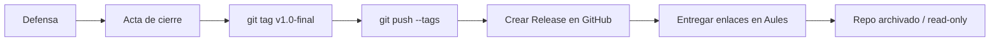

# 8. Presentación, defensa y cierre

> En esta última unidad demostrarás el **dominio integral** del proyecto: explicarás **qué hiciste**, **cómo lo hiciste**, **por qué tomaste cada decisión** y mostrarás **una demo funcional** en vivo. La defensa final es **la prueba de que todo lo anterior funciona y es tuyo**.
>
> Para ello, este tema proporciona:
>
> - Las **rúbricas integradas** del proyecto completo (de RA1 a RA5).
> - Los **instrumentos de evaluación** listos para usar en el aula.
> - Las **plantillas** de presentación, demo y Q&A.
> - Los **checklist** de preparación y de defensa.
> - Los procedimientos de **autoevaluación** y cierre del proyecto.

Esta unidad de trabajo corresponde principalmente al **Resultado de Aprendizaje RA5**, integrando la evaluación final de **RA1, RA2, RA3 y RA4**.

!!! tip "Idea clave del tema"
    La defensa **no es un examen** sobre tu memoria: es una **conversación técnica** en la que el tribunal valida que el proyecto que defiendes es **realmente tuyo**, que **lo entiendes** y que **podrías reproducirlo o mantenerlo** en un entorno profesional.

---

## Resultado de aprendizaje

Al finalizar esta unidad, serás capaz de:

- **RA5:** **Comunicar y colaborar** eficazmente, presentando y defendiendo el proyecto ante audiencia técnica con apoyo escrito y visual, gestionando preguntas y demostrando responsabilidad sobre el trabajo realizado.
- **Cierre integrador de RA1-RA4:** acreditar el cumplimiento de los criterios de evaluación de **todos** los temas previos mediante el sitio web de la memoria, el repositorio y la demo funcional.

---

## 1. Visión general del cierre del proyecto

| Fase | Qué se valida | Resultado |
|------|---------------|-----------|
| **T1-T2. Herramientas y reto** | Entorno de trabajo, caracterización del reto y contexto | Base del proyecto |
| **T3-T4. Diseño y desarrollo** | Arquitectura, planificación, despliegue inicial y pruebas | Solución funcional |
| **T5-T6. Integración y despliegue** | Seguridad, validación, operación y despliegue manual documentado | Solución operable |
| **T7. Memoria publicada** | Documentación técnica, repositorio y publicación web | Evidencias trazables |
| **Preparación de la defensa** | Guion, demo, roles y tiempos | Defensa ensayada |
| **Presentación pública** | Contexto, problema, solución, arquitectura y resultados | Comunicación técnica |
| **Defensa técnica + Q&A** | Comprensión real, autoría y toma de decisiones | Validación del tribunal |
| **Demostración funcional** | Ejecución en vivo de la solución y pruebas clave | Evidencia operativa |
| **Autoevaluación + cierre** | Reflexión individual, mejoras y cierre del trabajo | Entrega final consolidada |

### 1.1. Estructura del evento de defensa

| Fase | Duración | Quién | Objetivo |
|------|----------|-------|----------|
| **1. Presentación** | 10-12 min | Equipo (todos hablan) | Contexto, problema, solución, arquitectura, resultados |
| **2. Demostración** | 8-10 min | Equipo (1-2 personas) | Mostrar la solución funcionando en vivo |
| **3. Defensa técnica (Q&A)** | 8-10 min | Tribunal pregunta a cualquier integrante | Comprobar comprensión real y autoría |
| **4. Autoevaluación + cierre** | 3-5 min | Equipo | Reflexión, mejoras, agradecimientos |

**Tiempo total recomendado:** 30-35 minutos por equipo.

### 1.2. Materiales que debe entregar el equipo (24 h antes)

1. **URL del sitio MkDocs** publicado (memoria técnica).
2. **URL del repositorio GitHub** con código y memoria.
3. **Vídeo backup** de la demo (3-5 min) por si falla la red el día de la defensa.
4. **Listado de roles** de cada integrante (matriz de responsabilidades).
5. **Autoevaluación previa** del equipo (cumplimentada).

---

## 2. Sistema de evaluación final del proyecto

El proyecto se evalúa de forma **acumulativa** a lo largo de todo el curso, pero la **nota final** se calcula con las siguientes ponderaciones por RA:

### 2.1. Distribución global por Resultado de Aprendizaje

| RA | Descripción | Peso | Origen principal de la nota |
|:--:|-------------|:----:|------------------------------|
| **RA1** | Caracteriza el reto y el contexto | **15%** | Defensa de la caracterización (Tema 2) + memoria cap. 3 |
| **RA2** | Planifica actividades, recursos, riesgos y cronograma | **25%** | RG301 (Tema 3) + memoria cap. 5 |
| **RA3** | Desarrolla y valida la solución | **25%** | RG401 (Tema 4) + RG501/RG502 (Tema 5) + RG601/RG602 (Tema 6) |
| **RA4** | Documenta, versiona y despliega | **20%** | Repositorio Git + RG701/RG702 (Tema 7) + despliegue manual del Tema 6 |
| **RA5** | Comunica y colabora | **15%** | Defensa final (este tema) + Pull Requests + diario de aprendizaje |
| | **Total** | **100%** | |

### 2.2. Instrumentos de evaluación del Tema 8

| Instrumento | Icono | Puntos |
|-------------|-------|:------:|
| **Defensa y entrega final integrada (RG801)** | :material-presentation: | **100** |

La evaluación del Tema 8 se concentra en **una única actividad** que integra la defensa oral, la demostración funcional, la memoria técnica publicada y los entregables finales. El tribunal aplica la rúbrica del apartado 3.

> Esta nota se integra con las de los temas anteriores en la nota global del módulo siguiendo las ponderaciones del apartado 2.1.

---

## 3. Rúbrica integrada de la defensa final (100 puntos)

Esta rúbrica es la que **el tribunal aplica el día de la defensa y en la revisión previa de la memoria**. Incluye criterios de **todos los RA**, porque la defensa es la prueba transversal del módulo. La puntuación total de **RG801** es **100 puntos**.

### 3.1. Resumen por criterio

| # | Criterio | Máx. |
|:-:|----------|:----:|
| C1 | Caracterización y comprensión del reto (RA1) | 9 |
| C2 | Diseño y planificación (RA2) | 9 |
| C3 | Desarrollo, integración y seguridad (RA3) | 13 |
| C4 | Despliegue manual y operación (RA3+RA4) | 11 |
| C5 | Memoria técnica y repositorio (RA4) | 13 |
| C6 | Presentación oral y soporte visual (RA5) | 11 |
| C7 | Demostración funcional en vivo (RA3+RA5) | 13 |
| C8 | Defensa técnica y Q&A (RA1-RA5) | 9 |
| C9 | Trabajo colaborativo y autoría (RA5) | 12 |
|   | **Total** | **100** |

!!! note "Ponderación de C9"
    **C9** pasa de 2 a **12 puntos** (12 % del total) para que la colaboración y la autoría tengan un impacto real en la nota. Los 10 puntos restantes se redistribuyen de forma proporcional entre C1–C8, manteniendo **C5** como criterio de mayor peso (memoria y repositorio) y preservando la importancia relativa del resto. Las evidencias de C9 (matriz de roles, tablero, commits, PR, issues y desempeño en la defensa) permiten al tribunal discriminar la contribución individual dentro de la evaluación grupal.

### 3.2. Niveles de desempeño por criterio

#### C1. Caracterización y comprensión del reto (9 puntos)

| Nivel | Indicadores observables | Puntos |
|:-----:|--------------------------|:------:|
| **Excelente** | Contexto de la empresa simulada bien presentado; problemática justificada con datos; objetivos; alcance claro; interesados identificados | 9 |
| **Notable** | Caracterización completa con algún aspecto mejorable; objetivos algo genéricos | 6 |
| **Aprobado** | Caracterización presente pero superficial; problemática difusa | 4 |
| **Insuficiente** | Sin contexto claro o no demuestra entender por qué hace el proyecto | 0 |

#### C2. Diseño y planificación (9 puntos)

| Nivel | Indicadores observables | Puntos |
|:-----:|--------------------------|:------:|
| **Excelente** | Diagrama de arquitectura coherente con lo desplegado; modelo de datos correcto; EDT/WBS; cronograma con hitos y desviaciones reconocidas; riesgos | 9 |
| **Notable** | Diseño claro con pequeñas incoherencias respecto al despliegue real | 6 |
| **Aprobado** | Diagrama y planificación básicos; faltan partes (riesgos, ruta crítica…) | 4 |
| **Insuficiente** | Sin arquitectura o no se corresponde con la solución mostrada | 0 |

#### C3. Desarrollo, integración y seguridad (13 puntos)

| Nivel | Indicadores observables | Puntos |
|:-----:|--------------------------|:------:|
| **Excelente** | Stack completo desplegado y comunicado; persistencia probada; **hardening** (Nginx/SG/SSH/IAM) aplicado; pruebas negativas evidenciadas; backups operativos | 13 |
| **Notable** | Stack operativo con seguridad básica aplicada y verificada | 9 |
| **Aprobado** | Funciona pero seguridad mínima; faltan pruebas o evidencias | 5-6 |
| **Insuficiente** | No funciona end-to-end o sin medidas de seguridad | 0 |

#### C4. Despliegue manual y operación (11 puntos)

| Nivel | Indicadores observables | Puntos |
|:-----:|--------------------------|:------:|
| **Excelente** | Infraestructura y servicios desplegados manualmente de forma documentada y reproducible; procedimiento paso a paso en la memoria; servicios operativos; backups probados; monitorización básica; manual de operación claro | 11 |
| **Notable** | Despliegue manual funcional con documentación adecuada; algún paso poco detallado | 8 |
| **Aprobado** | Despliegue manual básico pero incompleto o poco documentado | 4-5 |
| **Insuficiente** | Sin evidencias de despliegue coherente o servicios no operativos | 0 |

#### C5. Memoria técnica y repositorio (13 puntos)

| Nivel | Indicadores observables | Puntos |
|:-----:|--------------------------|:------:|
| **Excelente** | Sitio MkDocs publicado y accesible; estructura completa; manuales de usuario y administrador; matriz de trazabilidad; repositorio con PR/Issues activos; `README.md` profesional; despliegue automático de la memoria funcionando | 13 |
| **Notable** | Memoria publicada con casi todos los capítulos; repositorio bien organizado | 9 |
| **Aprobado** | Memoria parcial; repositorio con commits genéricos y poca colaboración visible | 5-6 |
| **Insuficiente** | Sin sitio publicado o sin repositorio organizado | 0 |

#### C6. Presentación oral y soporte visual (11 puntos)

| Nivel | Indicadores observables | Puntos |
|:-----:|--------------------------|:------:|
| **Excelente** | Estructura clara (intro / problema / solución / resultados / cierre); todos los integrantes hablan; soporte visual limpio y legible; tiempos ajustados; lenguaje técnico preciso; contacto visual y soltura | 11 |
| **Notable** | Presentación correcta y dentro del tiempo; soporte visual adecuado | 8 |
| **Aprobado** | Comprensible pero desorganizada; alguien copa el tiempo, otros casi no hablan | 4-5 |
| **Insuficiente** | Por debajo del tiempo, lectura literal del soporte visual, sin estructura | 0 |

#### C7. Demostración funcional en vivo (13 puntos)

| Nivel | Indicadores observables | Puntos |
|:-----:|--------------------------|:------:|
| **Excelente** | Demo en vivo cubre los flujos principales; incluye una **prueba negativa** (intento bloqueado, recuperación) y un **caso de éxito** completo; navegación fluida | 13 |
| **Notable** | Demo funcional, alguna incidencia menor resuelta en directo | 9 |
| **Aprobado** | Demo limitada o con vídeo pre-grabado completo (sin parte en vivo) | 5-6 |
| **Insuficiente** | Sin demo o no funciona | 0 |

#### C8. Defensa técnica y Q&A (9 puntos)

| Nivel | Indicadores observables | Puntos |
|:-----:|--------------------------|:------:|
| **Excelente** | Cualquier integrante responde sobre cualquier área; justifican decisiones; reconocen limitaciones; proponen mejoras realistas | 9 |
| **Notable** | Mayoría responde con solvencia; algún área la conoce sólo un miembro | 6 |
| **Aprobado** | Respuestas correctas pero superficiales; depende mucho de un integrante | 4 |
| **Insuficiente** | No saben justificar decisiones técnicas o el equipo no conoce el trabajo de los demás | 0 |

#### C9. Trabajo colaborativo y autoría (12 puntos)

El tribunal valora el **patrón de colaboración del equipo** a partir de las evidencias de cada integrante (matriz de roles, tablero, commits, PR, issues, memoria y desempeño en la defensa). Una puntuación baja en C9 suele indicar que algún miembro ha tenido una implicación mínima; las observaciones de la ficha pueden detallar la valoración individual.

| Nivel | Indicadores observables | Puntos |
|:-----:|--------------------------|:------:|
| **Excelente** | Reparto equilibrado y documentado; **todos los integrantes** con autoría trazable, tareas cumplidas y capacidad de explicar y defender su aportación; al menos uno con **responsabilidad destacada** en áreas clave del proyecto; apoyo mutuo habitual en revisiones e incidencias | 12 |
| **Notable** | Colaboración constante del equipo; **cada integrante** con contribución adecuada y verificable en repositorio y memoria; cumplimiento habitual de las tareas asignadas; algún desequilibrio menor en protagonismo o en la defensa de su trabajo | 8 |
| **Aprobado** | Participación desigual: **uno o más integrantes** con colaboración parcial, autoría limitada o defensa superficial de su aportación; tareas cumplidas solo en parte; el equipo compensa parcialmente las carencias de los miembros menos implicados | 4 |
| **Insuficiente** | **Implicación mínima** de parte del equipo o trabajo concentrado en uno o dos integrantes; ausencia de autoría trazable; uno o más miembros no pueden explicar ni defender su aportación al proyecto | 0 |

---

## 4. Estudio libre

Terraform y otras herramientas de **infraestructura como código** pueden formar parte del estudio personal del alumnado interesado, pero **no forman parte de los contenidos evaluables** del módulo ni de la defensa final.

El alumnado que desee profundizar puede consultar el material del Tema 6 y recursos adicionales de forma autónoma. La evaluación del despliegue se centra en el **despliegue manual documentado** de la infraestructura y los servicios.

---

## 5. Revisión final

!!! note "Terraform fuera de la evaluación"
    **Terraform queda como contenido de ampliación y estudio libre para el alumnado interesado, pero no formará parte de la evaluación del proyecto ni de la defensa.**

La rúbrica integrada del apartado 3 valora únicamente el **despliegue manual** de la infraestructura y los servicios. Cualquier criterio, indicador o evidencia relacionado con Terraform, Ansible como automatización de despliegue o infraestructura como código **no se puntúa** en la defensa final.

---

## 6. Rúbrica complementaria de la memoria técnica (referencia para C5)

Esta rúbrica se aplica **antes** de la defensa, al revisar el sitio publicado y el repositorio. Integra criterios del **Tema 3 (RG301)**, **Tema 4 (RG401)**, **Tema 5 (RG501/RG502)**, **Tema 6 (RG601/RG602)** y **Tema 7 (RG701/RG702)**. Los indicadores orientan la puntuación de **C5** dentro de la rúbrica integrada de 100 puntos.

| Criterio | Tema asociado | Peso relativo |
|----------|---------------|:-------------:|
| Caracterización y análisis (capítulos 3-4) | T2 | Alto |
| Diseño y planificación (capítulo 5) | T3 (RG301) | Alto |
| Desarrollo (capítulo 6) | T4 (RG401) | Alto |
| Integración y seguridad (capítulo 7) | T5 (RG501/RG502) | Alto |
| Despliegue manual y operación (capítulo 8) | T6 (RG601/RG602) | Muy alto |
| Pruebas y evidencias (capítulo 9) | T4-T6 | Medio |
| Documentación, estructura y publicación | T7 (RG701) | Alto |
| Manuales de usuario y administrador | T7 (RG702) | Medio |
| Repositorio GitHub (commits, ramas, PR, issues) | T7 | Bajo |

### 6.1. Criterios específicos relacionados con despliegue manual y operación

| # | Criterio observable en la memoria | Observación |
|:-:|------------------------------------|-------------|
| 1 | Existe capítulo dedicado al **despliegue manual** documentado paso a paso | Esencial |
| 2 | Se documenta la **configuración de servicios** (web, base de datos, proxy, etc.) | Esencial |
| 3 | Se evidencian **procedimientos de backup y restauración** probados | Importante |
| 4 | Se documenta la **gestión de secretos** (variables de entorno, permisos, no claves en el repositorio) | Importante |
| 5 | Se incluye **manual de operación** y **monitorización básica** | Importante |

### 6.2. Criterios específicos relacionados con el despliegue manual documentado

| # | Criterio observable | Observación |
|:-:|---------------------|-------------|
| 1 | Procedimiento reproducible por un tercero siguiendo la memoria | Esencial |
| 2 | Capturas o evidencias de cada fase del despliegue | Importante |
| 3 | Configuración de red, puertos y firewall documentada | Importante |
| 4 | Variables y parámetros explicados (no valores hardcoded sin contexto) | Importante |
| 5 | `.gitignore` correcto (sin claves ni datos sensibles) | Importante |
| 6 | Verificación post-despliegue documentada (servicios activos, acceso web) | Esencial |
| 7 | Registro de incidencias durante el despliegue y su resolución | Deseable |
| 8 | Manual de operación con tareas habituales (reinicio, logs, backups) | Importante |

### 6.3. Criterios específicos relacionados con documentación técnica

| # | Criterio observable | Puntos |
|:-:|---------------------|:------:|
| 1 | Sitio MkDocs Material publicado | 1 |
| 2 | Estructura coherente con la propuesta (capítulos 1-11) | 1 |
| 3 | Uso correcto de admonitions, tablas y bloques de código | 0.5 |
| 4 | Al menos 1 diagrama Mermaid por capítulo técnico | 0.5 |
| 5 | Capturas con calidad profesional (sin datos sensibles) | 0.5 |
| 6 | Glosario, bibliografía y licencia presentes | 0.5 |

### 6.4. Criterios específicos relacionados con GitHub y memoria del proyecto

| # | Criterio observable | Puntos |
|:-:|---------------------|:------:|
| 1 | Repositorio público con `README.md` profesional | 0.25 |
| 2 | Despliegue automático con GitHub Actions funcionando | 0.25 |
| 3 | Commits repartidos entre los miembros del equipo | 0.25 |
| 4 | Uso de Pull Requests con revisión técnica documentada | 0.25 |

---

## 7. Rúbrica de presentación oral (incluida dentro de la defensa)

Esta rúbrica detalla **C6 (Presentación oral)** y **C7 (Demostración)** de la rúbrica principal. Resulta útil al tribunal para puntuar con precisión.

### 7.1. Aspectos comunicativos

| Aspecto | Excelente (1) | Notable (0,75) | Aprobado (0,5) | Insuficiente (0) |
|---------|----------------|----------------|----------------|------------------|
| **Estructura del discurso** | Clara, con apertura, desarrollo y cierre | Estructura visible con algún salto | Confusa, ideas desordenadas | Sin estructura |
| **Gestión del tiempo** | Dentro del tiempo asignado (±1 min) | Pequeño desajuste (±2 min) | Desajuste evidente (±3 min) | Muy fuera del tiempo |
| **Lenguaje técnico** | Preciso y adecuado | Adecuado con algún error puntual | Términos genéricos o imprecisos | Errores técnicos serios |
| **Contacto visual y postura** | Mira al tribunal y al auditorio | Mantiene contacto la mayor parte | Lee mucho | No mira / da la espalda |
| **Reparto de tiempo entre integrantes** | Equilibrado | Ligeramente desigual | Desigual | Uno habla casi todo |
| **Soporte visual** | Profesional, claro, sin texto excesivo | Adecuado, mejorable | Sobrecargado o pobre | Ilegible o ausente |

### 7.2. Aspectos demostrativos (demo en vivo)

| Aspecto | Excelente | Notable | Aprobado | Insuficiente |
|---------|-----------|---------|----------|--------------|
| **Cobertura de funcionalidades** | Cubre los flujos críticos y un caso secundario | Cubre los críticos | Solo uno o dos flujos | No demuestra funcionalidad |
| **Manejo de la consola/IDE** | Soltura, atajos, comandos preparados | Manejo correcto | Lento o titubeante | Pierde el control de la herramienta |
| **Gestión de imprevistos** | Resuelve un fallo en directo con criterio | Maneja la incidencia con apoyo | Se bloquea pero sigue con vídeo | No reacciona ante fallo |
| **Evidencia de seguridad** | Muestra una prueba negativa real | Muestra control de acceso | Solo lo menciona | No la trata |

---

## 8. Rúbrica de defensa técnica (Q&A)

Esta sección guía al tribunal para **preguntar con criterio** y al equipo para **prepararse**.

### 8.1. Banco de preguntas tipo por RA

??? question "Preguntas tipo — RA1 (Caracterización)"
    1. ¿A qué problema concreto responde vuestra solución?
    2. ¿Qué otra alternativa de proyecto descartasteis y por qué?
    3. ¿Quiénes son los interesados clave? ¿Cómo influye eso en vuestras decisiones?
    4. ¿Qué requisito **no funcional** os marcó más el diseño?

??? question "Preguntas tipo — RA2 (Diseño y planificación)"
    1. ¿Por qué elegisteis [Docker | AWS] y no la otra opción?
    2. Mostrad la ruta crítica del cronograma. ¿Dónde se desviaron las fechas?
    3. ¿Qué riesgo se materializó y cómo lo gestionasteis?
    4. ¿Cómo es la topología de red? ¿Por qué esa segmentación?
    5. Justificad el modelo de datos: relaciones, integridad referencial, índices.

??? question "Preguntas tipo — RA3 (Desarrollo, integración, seguridad)"
    1. ¿Cómo persistís los datos? ¿Qué pasaría si se reinicia la máquina ahora?
    2. ¿Qué medidas de hardening aplicasteis y por qué esas?
    3. Mostrad que el puerto 3306 **no** es accesible desde fuera del SG `web`.
    4. ¿Cómo se realizan los backups y cuándo se restauró por última vez uno?
    5. Si os pidieran cumplir HTTPS, ¿qué cambiaríais y qué coste tendría?

??? question "Preguntas tipo — RA3+RA4 (Despliegue manual y operación)"
    1. Si destruyera ahora las máquinas, ¿cuánto tardaríais en reconstruirlas siguiendo vuestra documentación?
    2. Mostrad el procedimiento de despliegue manual documentado en la memoria. ¿Qué paso es el más crítico?
    3. ¿Cómo verificáis que los servicios están operativos tras el despliegue?
    4. ¿Dónde están los secretos? ¿Cómo evitáis exponerlos en el repositorio?
    5. ¿Qué métrica/alarma os avisaría de una caída?

??? question "Preguntas tipo — RA4 (Documentación)"
    1. Enseñadme la matriz de trazabilidad: elegid un RF y seguidlo hasta la evidencia.
    2. ¿Cómo se publica vuestra memoria? Mostrad el workflow Actions.
    3. ¿Qué cambia si un compañero ajeno al equipo quiere contribuir?
    4. Mostrad la incidencia más interesante del registro y cómo se cerró.

??? question "Preguntas tipo — RA5 (Comunicación y colaboración)"
    1. ¿Cuál fue el principal conflicto del equipo y cómo se gestionó?
    2. ¿Cuál es vuestra mejor aportación individual? (cada integrante responde)
    3. Si tuvieseis 1 mes más, ¿en qué lo invertiríais?
    4. ¿Qué módulos del ciclo se ven más reflejados en este proyecto?

### 8.2. Indicador clave: **transferibilidad del conocimiento**

El tribunal puede dirigir cualquier pregunta a cualquier integrante. El indicador es claro:

| Situación | Lectura del tribunal |
|-----------|----------------------|
| Cualquier integrante responde sobre cualquier área | Trabajo cooperativo real |
| Cada pregunta tiene un "experto" único | Trabajo dividido pero sin compartir conocimiento |
| Una persona responde casi todo | Riesgo de autoría desigual; bajada de C9 |
| Respuestas evasivas o sin referencias a la memoria | Memoria no asimilada |

---

## 9. Instrumentos de evaluación listos para el aula

### 9.1. Ficha de evaluación del tribunal

```markdown
# Ficha de evaluación — Defensa Proyecto Intermodular ASIR

**Equipo:** ____________________________________
**Reto / Línea:** [ ] Docker (RG501/RG601)  [ ] AWS (RG502/RG602)
**Fecha:** __________  **Hora:** __________
**Evaluador/a:** ______________________________

## Puntuación por criterio

| # | Criterio | Máx. | Otorgado | Notas |
|:-:|----------|:----:|:--------:|-------|
| C1 | Caracterización (RA1) | 9 |   |  |
| C2 | Diseño y planificación (RA2) | 9 |   |  |
| C3 | Desarrollo, integración y seguridad (RA3) | 13 |   |  |
| C4 | Despliegue manual y operación (RA3+RA4) | 11 |   |  |
| C5 | Memoria técnica y repositorio (RA4) | 13 |   |  |
| C6 | Presentación oral (RA5) | 11 |   |  |
| C7 | Demostración funcional (RA3+RA5) | 13 |   |  |
| C8 | Defensa técnica y Q&A (RA1-RA5) | 9 |   |  |
| C9 | Trabajo colaborativo y autoría (RA5) | 12 |   |  |
|   | **TOTAL** | **100** |   |  |

## Observaciones cualitativas

**Puntos fuertes:**
- ...

**Áreas de mejora:**
- ...

**Recomendación final:**
[ ] Apto — Excelente   [ ] Apto — Notable   [ ] Apto — Aprobado   [ ] No apto (justificar)
```

### 9.2. Ficha de autoevaluación individual

```markdown
# Autoevaluación individual

**Nombre:** _________________

## 1. Aportación al proyecto

- Capítulos de la memoria que redacté: ...
- Componentes técnicos en los que trabajé: ...
- Issues que cerré: #..., #..., #...
- PR abiertos: #..., #..., #...

## 2. Reflexión sobre mi aprendizaje

| Aspecto | Antes del módulo | Después del módulo |
|---------|------------------|---------------------|
| Git/GitHub | ... | ... |
| Docker/AWS | ... | ... |
| Despliegue manual | ... | ... |
| MkDocs | ... | ... |

## 3. Compromisos para mi futuro profesional

- ...
- ...
```

---

## 10. Preparación de la presentación

### 10.1. Estructura recomendada de la presentación

| Bloque | Título | Contenido | Tiempo |
|:----:|--------|-----------|:------:|
| 1 | Portada | Título, empresa simulada, equipo, fecha, IES | 30 s |
| 2 | Contexto | Empresa, problema, oportunidad | 1 min |
| 3 | Objetivos y alcance | Objetivosx, dentro/fuera del alcance | 1 min |
| 4 | Arquitectura | Diagrama de arquitectura final | 1 min |
| 5 | Stack tecnológico | Tabla con tecnologías y por qué | 1 min |
| 6 | Diseño de datos | Modelo entidad-relación | 30 s |
| 7 | Planificación | Cronograma + hitos | 1 min |
| 8 | Desarrollo | Iteraciones, decisiones clave | 1 min |
| 9 | Integración + seguridad | Medidas, pruebas negativas | 1 min |
| 10 | Despliegue manual | Procedimiento documentado, servicios operativos | 1 min |
| 11 | Demo en vivo (anunciar) | "Pasemos a la demo" | 10 s |
| 12 | Resultados y métricas | Objetivos alcanzados | 1 min |
| 13 | Conclusiones | Lecciones aprendidas, mejoras futuras | 1 min |
| 14 | Q&A | "Preguntas" | – |
| 15 | Gracias + contacto | Equipo, repositorio, URL | – |

### 10.2. Reglas de diseño del soporte visual

- **6 x 6:** máximo 6 ideas por pantalla, máximo 6 palabras por idea.
- **1 imagen / diagrama por pantalla** como protagonista.
- **Sin párrafos largos**: si necesitas texto, está en la memoria, no en el soporte visual.
- **Mismo tipo de letra y paleta** en todo el documento.
- **Numeración de secciones** visible (ayuda al tribunal a tomar notas).
- **Material de respaldo** con capturas por si la demo falla.

### 10.3. Ensayo y *time-boxing*

| Día previo | Actividad |
|------------|-----------|
| **-7 a -4** | Primera versión del guion y soporte visual; reparto de turnos de habla |
| **-3 a -2** | Ensayo cronometrado completo (2 veces) |
| **-1** | Ensayo con público (otro equipo o tutor); ajustes finales |
| **Día D** | Llegar 30 min antes; comprobar HDMI, sonido, red, demo, backup |

---

## 11. Demostración funcional en vivo

### 11.1. Guion mínimo de la demo

| Bloque | Acción | Resultado esperado |
|--------|--------|--------------------|
| 1. Despliegue manual | Seguir el procedimiento documentado (o vídeo si tarda demasiado) | Servicios desplegados |
| 2. Configuración | Verificar servicios activos y conectividad | Servicios operativos |
| 3. Acceso público | Abrir la URL en navegador | Carga la web |
| 4. Caso de éxito | Hacer una operación real (login, crear post, etc.) | Funciona y persiste |
| 5. Persistencia | Reiniciar servicio y volver a entrar | Datos siguen ahí |
| 6. Seguridad | Probar acceso bloqueado desde IP no autorizada | Acceso denegado |
| 7. Operación | Mostrar última copia / log relevante | Evidencia profesional |

### 11.2. Plan B: vídeo de respaldo

- Vídeo de 3-5 minutos, narrado.
- Hospedado en YouTube (no listado) o en el repositorio.
- Enlazado desde el guion de la demo.
- Calidad mínima: 1080p, audio claro.

### 11.3. Errores frecuentes durante la demo

| Error | Cómo prevenirlo |
|-------|-----------------|
| "Aquí no funciona la red" | Tener todo posible *offline*; vídeo backup |
| "Se me ha olvidado el comando" | Tener un fichero `demo.sh` listo y abierto |
| "Esto tarda mucho…" | Pre-calentar (instancias creadas antes) o usar vídeo |
| "No sé por qué pasa esto ahora" | Probar la demo la noche anterior, **misma red** que en la defensa |

---

## 12. Checklist de defensa final

### 12.1. Checklist técnico (T-24 h)

- [ ] Sitio MkDocs publicado y accesible.
- [ ] Repositorio GitHub público y actualizado.
- [ ] Despliegue funcional probado **hoy**.
- [ ] Backup de la base de datos creado y verificado.
- [ ] Credenciales de acceso al entorno disponibles.
- [ ] Vídeo de la demo grabado y enlazado.
- [ ] Diagramas en PNG + originales editables.

### 12.2. Checklist organizativo (T-24 h)

- [ ] Reparto de turnos de palabra acordado y ensayado.
- [ ] Tiempos cronometrados (presentación + demo).
- [ ] Banco de preguntas tipo repasado por todo el equipo.
- [ ] Autoevaluación individual cumplimentada.
- [ ] Aula y equipo de proyección reservados.
- [ ] Persona designada para gestionar el portátil/proyector.

### 12.3. Checklist el día de la defensa (T-0)

- [ ] Llegar 30 min antes.
- [ ] Probar HDMI / adaptador / cable de red.
- [ ] Abrir y precargar: terminal, navegador, memoria publicada y vídeo backup.
- [ ] Silenciar notificaciones, modo "no molestar".
- [ ] Vasos de agua para el equipo.
- [ ] Ropa profesional cómoda.
- [ ] Respirar, sonreír, recordar: **conoces tu proyecto**.

---

## 13. Cierre del proyecto

### 13.1. Acta de cierre del proyecto

Tras la defensa, el equipo redacta una **acta de cierre** que incorpora a la memoria como anexo. Plantilla:

```markdown
# Acta de cierre del Proyecto Intermodular

**Equipo:** ...
**Fecha de cierre:** ...
**URL de la memoria:** ...
**URL del repositorio:** ...

## Objetivos alcanzados

- [x] Objetivo 1
- [x] Objetivo 2
- [ ] Objetivo 3 (parcial; ver §...)

## Productos entregados

- Memoria técnica publicada.
- Repositorio Git con código de aplicación, configuración y documentación de despliegue manual.
- Manuales de usuario y administrador.
- Vídeo de la demo.

## Métricas finales

| Métrica | Valor |
|---------|------:|
| Commits totales | ... |
| Pull Requests | ... |
| Issues cerrados | ... |
| Capturas en la memoria | ... |
| Diagramas Mermaid | ... |
| Horas estimadas | ... |
| Coste AWS (€) | ... |

## Lecciones aprendidas

1. ...
2. ...
3. ...

## Mejoras futuras

1. ...
2. ...
3. ...

## Firmas

- [ ] Alumno/a 1
- [ ] Alumno/a 2
- [ ] Alumno/a 3
```

### 13.2. Entrega final y archivo



Procedimiento:

1. **`git tag v1.0-final`** y `git push --tags`.
2. Crear una **Release** en GitHub con el changelog del proyecto.
3. Entregar en **Aules**: URL de la memoria, URL del repositorio, vídeo y autoevaluación.
4. (Opcional) Archivar el repositorio (`Settings → Archive this repository`) tras la defensa para que conste como "estado final".

### 13.3. Reflexión final del equipo

A modo de cierre y retrospectiva:

| Pregunta | Respuesta del equipo |
|----------|----------------------|
| ¿Qué nos llevamos como aprendizaje técnico? | ... |
| ¿Qué nos llevamos como aprendizaje personal? | ... |
| ¿Qué haríamos diferente si empezáramos hoy? | ... |
| ¿Qué módulos del ciclo nos han resultado más útiles? | ... |
| ¿En qué área profesional nos vemos en 1-2 años? | ... |

---

## 14. Actividades y entregables

<a name="RG801"></a>

* :material-presentation: **RG801**. (RA4+RA5 // **100p**). **Defensa y entrega final integrada**: presentación (10-12 min), demostración funcional (8-10 min), defensa técnica (Q&A, 8-10 min), memoria publicada, repositorio, manuales, matriz de trazabilidad, registro de incidencias, vídeo de demo, acta de cierre y autoevaluación individual. Rúbrica del apartado 3.

**Entregables consolidados (Aules):**

1. URL de la memoria (sitio MkDocs).
2. URL del repositorio GitHub.
3. Vídeo de la demo (URL o archivo).
4. Acta de cierre.
5. Ficha de autoevaluación (1 por integrante).

---

## 15. Recursos y referencias

### Material del módulo

- [Tema 5 — Integración, seguridad y validación](05integracion.md)
- [Tema 6 — Despliegue y operación](06despliegue_operacion.md)
- [Tema 7 — Documentación técnica y memoria](07documentacion_memoria.md)
- [Rúbrica RG301 — Diseño y planificación](rubrica_RG301_Diseno_Planificacion.md)
- [Rúbrica RG401 — Desarrollo iterativo y pruebas](rubrica_RG401_Desarrollo.md)
- [Rúbrica defensa de la caracterización](rubrica_defensa_caracterizacion.md)

### Proyectos reales del alumnado ASIR (referencia para preparar la defensa)

- :material-book-open-page-variant: [Proyecto Intermodular Docker (IJJ)](https://elimpermeable.github.io/Proyecto_Intermodular2ASIR_IJJ/) — [Repositorio](https://github.com/elimpermeable/Proyecto_Intermodular2ASIR_IJJ).
- :material-book-open-page-variant: [Proyecto Intermodular AWS (Alejandro Mariño)](https://alejandromarinyo.github.io/Proyecto-Intermodular/) — [Repositorio](https://github.com/AlejandroMarinyo/Proyecto-Intermodular).

### Lecturas recomendadas

- *The Pyramid Principle* — Barbara Minto (estructura de presentaciones).
- *Presentation Zen* — Garr Reynolds (diseño de presentaciones).
- *The Phoenix Project* — Gene Kim (cultura DevOps).
- *Site Reliability Engineering* — Google (operación profesional).

---

## Glosario de términos y acrónimos

- **Defensa técnica:** acto evaluable en el que el equipo expone, demuestra y responde sobre su proyecto
- **Q&A:** *Questions & Answers*, fase de preguntas del tribunal
- **Tribunal:** profesorado evaluador (módulos implicados)
- **Demo:** demostración funcional en vivo (o con vídeo de respaldo)
- **Rúbrica:** instrumento de evaluación con criterios, niveles e indicadores
- **Autoevaluación:** evaluación de uno mismo según criterios definidos
- **Acta de cierre:** documento final que oficializa la entrega del proyecto
- **Release:** versión etiquetada y publicada en GitHub
- **RA1-RA5:** Resultados de Aprendizaje del módulo
- **CE:** Criterios de Evaluación asociados a cada RA
- **Despliegue manual:** procedimiento documentado para instalar y configurar la infraestructura y los servicios sin automatización evaluable

---

## Conclusión y siguientes pasos

Has llegado al final del módulo. Tu proyecto, si has seguido los temas 1-8, debería ser:

- **Funcional:** desplegado, validado, seguro y operable.
- **Reproducible:** cualquiera puede levantarlo desde el repositorio.
- **Documentado:** la memoria publicada lo explica todo.
- **Defendible:** el equipo conoce y justifica cada decisión.
- **Profesional:** podrías enseñarlo en una entrevista de trabajo **mañana mismo**.

> Ese **"mañana mismo"** no es un final: es **el inicio de tu carrera profesional**. El Proyecto Intermodular es la primera línea de tu portfolio técnico. Mantén el repositorio vivo, sigue mejorándolo y enlázalo en tu CV.

**Buena defensa y mucha suerte.**
