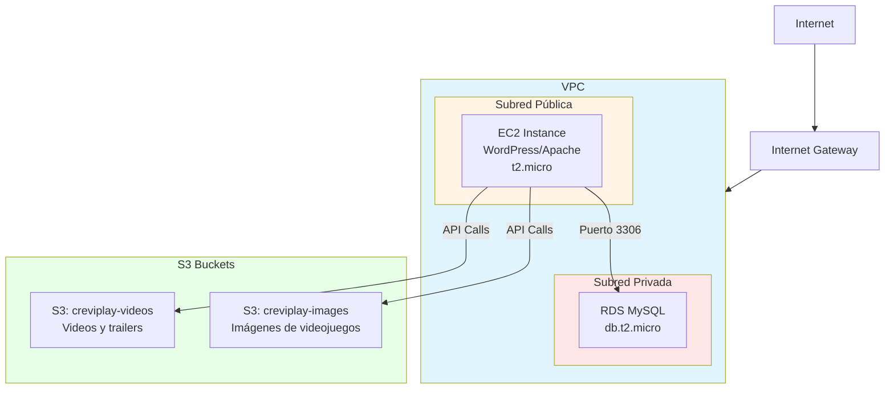
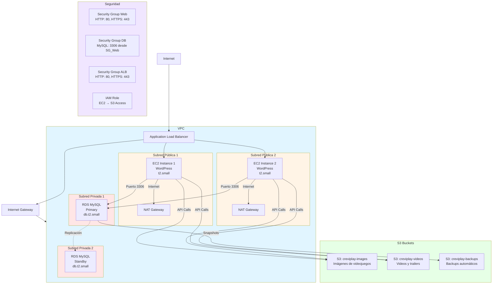

# Infraestructura completa de TI para CreviPlay con AWS

Esta práctica guía la implementación de una infraestructura completa de TI en AWS para **CreviPlay**, un estudio de desarrollo de videojuegos independiente. Se desplegará una arquitectura escalable y segura que incluye servidor web, base de datos, almacenamiento y todos los servicios necesarios para operar profesionalmente.

## Objetivos de la práctica

- Diseñar y configurar una VPC con subredes públicas y privadas
- Desplegar instancia EC2 para servidor web con WordPress
- Configurar RDS para base de datos MySQL/PostgreSQL
- Configurar buckets S3 para almacenamiento de recursos multimedia
- Implementar medidas de seguridad (Security Groups, IAM, encriptación)
- Configurar respaldo automático y alta disponibilidad
- Documentar la arquitectura completa

## Arquitectura de la solución

La arquitectura propuesta separa los servicios en diferentes capas y zonas de disponibilidad para garantizar seguridad, escalabilidad y alta disponibilidad.

### Arquitectura básica (Opción 1: Inicio)

Esta arquitectura es ideal para comenzar y entender los conceptos fundamentales:



### Arquitectura avanzada (Opción 2: Producción)

Arquitectura más robusta con múltiples zonas de disponibilidad y balanceador de carga:



## Paso 1: Preparación del entorno AWS

### 1.1. Acceder a AWS mediante Learner Lab

El alumnado tiene acceso a AWS a través de **AWS Educate Learner Lab**, que proporciona un entorno de práctica con créditos limitados para realizar las prácticas.

**Acceso a Learner Lab:**

1. Accede a tu cuenta de **AWS Educate** (proporcionada por el centro educativo)
2. Navega a **Learner Lab** desde el dashboard
3. Inicia el laboratorio haciendo clic en **Start Lab**
4. Espera a que el entorno se inicialice (puede tardar 1-2 minutos)
5. Una vez iniciado, tendrás acceso a:
   - Consola de AWS con permisos limitados pero suficientes para esta práctica
   - Créditos AWS para usar servicios (con límites)
   - Acceso temporal (típicamente 4 horas, renovable)

!!! note "Importante sobre Learner Lab"
    - El entorno se reinicia periódicamente, por lo que los recursos creados pueden eliminarse
    - Los créditos son limitados, revisa el uso en el dashboard
    - Algunos servicios pueden tener restricciones (consulta la documentación de Learner Lab)
    - Guarda tus configuraciones y documentación fuera de AWS para no perderlas

**Si necesitas acceso permanente o más recursos:**

Para proyectos de larga duración o producción, puedes crear una cuenta AWS personal:
1. Accede a [https://aws.amazon.com](https://aws.amazon.com)
2. Crea una cuenta nueva (requiere tarjeta de crédito, pero puedes usar el tier gratuito)
3. Activa MFA (Multi-Factor Authentication) para mayor seguridad

### 1.2. Configurar AWS CLI (opcional pero recomendado)

Instala AWS CLI para gestionar recursos desde la línea de comandos:

```bash
# En Linux/Mac
curl "https://awscli.amazonaws.com/awscli-exe-linux-x86_64.zip" -o "awscliv2.zip"
unzip awscliv2.zip
sudo ./aws/install

# Verificar instalación
aws --version
```

Configura tus credenciales:

```bash
aws configure
```

**Para Learner Lab:**
1. En el dashboard de Learner Lab, haz clic en **AWS Details**
2. Copia las credenciales temporales (Access Key ID y Secret Access Key)
3. Introduce:

   - AWS Access Key ID: (del Learner Lab)
   - AWS Secret Access Key: (del Learner Lab)
   - Default region: `us-east-1` (o la región asignada en Learner Lab)
   - Default output format: `json`

!!! warning "Credenciales temporales"
    Las credenciales de Learner Lab son temporales y expiran cuando finaliza la sesión. Deberás actualizarlas cada vez que inicies un nuevo laboratorio.

**Para cuenta AWS personal:**
- Accede a **IAM** → **Users** → Tu usuario → **Security credentials**
- Crea Access Keys si no las tienes
- Configura AWS CLI con estas credenciales

### 1.3. Verificar permisos y servicios disponibles

En Learner Lab, algunos servicios pueden tener restricciones. Verifica que puedes acceder a:

1. **EC2**: Para crear instancias
2. **VPC**: Para crear redes y subredes
3. **RDS**: Para crear bases de datos (puede tener restricciones)
4. **S3**: Para crear buckets
5. **IAM**: Para crear roles (puede tener restricciones)

Si algún servicio no está disponible en Learner Lab, consulta con el profesorado sobre alternativas o uso de servicios equivalentes.

## Paso 2: Crear VPC y red

### 2.1. Crear VPC

1. Accede a **VPC** → **Your VPCs** → **Create VPC**
2. Configuración:

   - **Name tag**: `creviplay-vpc`
   - **IPv4 CIDR block**: `10.0.0.0/16`
   - **Tenancy**: Default
3. Clic en **Create VPC**

### 2.2. Crear subredes

**Subred pública 1:**
1. **VPC** → **Subnets** → **Create subnet**
2. Configuración:

   - **VPC**: Selecciona `creviplay-vpc`
   - **Subnet name**: `creviplay-public-subnet-1`
   - **Availability Zone**: `us-east-1a`
   - **IPv4 CIDR block**: `10.0.1.0/24`
3. Clic en **Create subnet**

**Subred privada 1:**
1. **Create subnet**
2. Configuración:

   - **VPC**: `creviplay-vpc`
   - **Subnet name**: `creviplay-private-subnet-1`
   - **Availability Zone**: `us-east-1b`
   - **IPv4 CIDR block**: `10.0.2.0/24`
3. Clic en **Create subnet**

### 2.3. Crear Internet Gateway

1. **VPC** → **Internet Gateways** → **Create internet gateway**
2. **Name tag**: `creviplay-igw`
3. Clic en **Create internet gateway**
4. Selecciona el IGW creado → **Actions** → **Attach to VPC**
5. Selecciona `creviplay-vpc` → **Attach internet gateway**

### 2.4. Configurar Route Tables

**Route Table pública:**
1. **VPC** → **Route Tables** → **Create route table**
2. Configuración:

   - **Name**: `creviplay-public-rt`
   - **VPC**: `creviplay-vpc`
3. Clic en **Create route table**
4. Selecciona la tabla → **Routes** → **Edit routes** → **Add route**

   - **Destination**: `0.0.0.0/0`
   - **Target**: Selecciona el Internet Gateway `creviplay-igw`
5. **Subnet associations** → **Edit subnet associations**

   - Selecciona `creviplay-public-subnet-1` → **Save associations**

**Route Table privada:**
1. **Create route table**
2. Configuración:

   - **Name**: `creviplay-private-rt`
   - **VPC**: `creviplay-vpc`
3. Clic en **Create route table**
4. No añadas ruta a Internet (permanece privada)

### 2.5. (Opcional) Crear NAT Gateway para subred privada

Si necesitas que las instancias en la subred privada accedan a Internet (para actualizaciones):

1. **VPC** → **NAT Gateways** → **Create NAT gateway**
2. Configuración:

   - **Subnet**: `creviplay-public-subnet-1`
   - **Elastic IP**: Crea una nueva Elastic IP
3. Clic en **Create NAT gateway**
4. Actualiza la route table privada:

   - **Route Tables** → `creviplay-private-rt` → **Routes** → **Edit routes**
   - **Add route**: `0.0.0.0/0` → Target: NAT Gateway creado

## Paso 3: Configurar Security Groups

### 3.1. Security Group para servidor web (EC2)

1. **VPC** → **Security Groups** → **Create security group**
2. Configuración:

   - **Name**: `creviplay-web-sg`
   - **Description**: `Security group for CreviPlay web server`
   - **VPC**: `creviplay-vpc`
3. **Inbound rules**:

   - **Type**: SSH, **Source**: `0.0.0.0/0` (o tu IP específica)
   - **Type**: HTTP, **Source**: `0.0.0.0/0`
   - **Type**: HTTPS, **Source**: `0.0.0.0/0`
4. **Outbound rules**: Mantener por defecto (todo el tráfico)
5. Clic en **Create security group**

### 3.2. Security Group para base de datos (RDS)

1. **Create security group**
2. Configuración:

   - **Name**: `creviplay-db-sg`
   - **Description**: `Security group for CreviPlay database`
   - **VPC**: `creviplay-vpc`
3. **Inbound rules**:

   - **Type**: MySQL/Aurora (3306), **Source**: Selecciona `creviplay-web-sg`
4. **Outbound rules**: Mantener por defecto
5. Clic en **Create security group**

## Paso 4: Crear instancia EC2

### 4.1. Lanzar instancia EC2

1. **EC2** → **Instances** → **Launch instances**
2. **Name**: `creviplay-web-server`
3. **AMI**: Selecciona **Amazon Linux 2023** (gratis)
4. **Instance type**: `t2.micro` (elegible para tier gratuito)
5. **Key pair**: Crea un nuevo key pair o selecciona uno existente

   - **Name**: `creviplay-keypair`
   - **Key pair type**: RSA
   - **Private key file format**: `.pem`
   - **Download** el archivo `.pem` y guárdalo de forma segura
6. **Network settings**:

   - **VPC**: `creviplay-vpc`
   - **Subnet**: `creviplay-public-subnet-1`
   - **Auto-assign Public IP**: Enable
   - **Security group**: Selecciona `creviplay-web-sg`
7. **Configure storage**: 8 GB gp3 (suficiente para inicio)
8. **Launch instance**

### 4.2. Conectar a la instancia EC2

```bash
# Cambiar permisos del archivo .pem
chmod 400 creviplay-keypair.pem

# Conectar por SSH
ssh -i creviplay-keypair.pem ec2-user@<IP_PUBLICA_EC2>
```

### 4.3. Instalar y configurar servidor web

Una vez conectado a la instancia:

```bash
# Actualizar sistema
sudo yum update -y

# Instalar Apache
sudo yum install httpd -y

# Instalar PHP y extensiones necesarias
sudo yum install php php-mysqlnd php-gd php-xml php-mbstring -y

# Instalar MySQL client (para pruebas)
sudo yum install mysql -y

# Iniciar y habilitar Apache
sudo systemctl start httpd
sudo systemctl enable httpd

# Verificar estado
sudo systemctl status httpd
```

### 4.4. Instalar WordPress

```bash
# Cambiar al directorio web
cd /var/www/html

# Descargar WordPress
sudo wget https://wordpress.org/latest.tar.gz

# Extraer archivo
sudo tar -xzf latest.tar.gz

# Mover archivos a raíz
sudo mv wordpress/* .
sudo rm -rf wordpress latest.tar.gz

# Configurar permisos
sudo chown -R apache:apache /var/www/html
sudo chmod -R 755 /var/www/html
```

## Paso 5: Configurar RDS (Base de datos)

### 5.1. Crear instancia RDS

1. **RDS** → **Databases** → **Create database**
2. **Database creation method**: Standard create
3. **Engine options**:

   - **Engine type**: MySQL
   - **Version**: MySQL 8.0.35 (o la más reciente)
4. **Templates**: Free tier (si está disponible) o Dev/Test
5. **Settings**:

   - **DB instance identifier**: `creviplay-db`
   - **Master username**: `admin`
   - **Master password**: Crea una contraseña segura y guárdala
6. **Instance configuration**:

   - **DB instance class**: `db.t2.micro` (free tier) o `db.t3.micro`
7. **Storage**:

   - **Storage type**: General Purpose SSD (gp3)
   - **Allocated storage**: 20 GB
   - **Enable storage autoscaling**: Opcional
8. **Connectivity**:

   - **VPC**: `creviplay-vpc`
   - **Subnet group**: Crea nuevo DB subnet group
     - **Name**: `creviplay-db-subnet-group`
     - **Subnets**: Selecciona `creviplay-private-subnet-1`
   - **Public access**: No (mantener privada)
   - **VPC security group**: Selecciona `creviplay-db-sg`
   - **Availability Zone**: `us-east-1b`
9.  **Database authentication**: Password authentication
10. **Additional configuration**:

    - **Initial database name**: `creviplay_db`
    - **Backup retention period**: 7 days
    - **Enable automated backups**: Yes
11. **Create database**

### 5.2. Obtener endpoint de RDS

Una vez creada la base de datos:

1. **RDS** → **Databases** → Selecciona `creviplay-db`
2. Copia el **Endpoint** (ejemplo: `creviplay-db.xxxxx.us-east-1.rds.amazonaws.com`)
3. Anota el **Port** (3306 por defecto)

### 5.3. Configurar WordPress para conectar a RDS

En la instancia EC2:

```bash
# Editar archivo de configuración de WordPress
sudo nano /var/www/html/wp-config.php
```

Actualiza las siguientes líneas con los datos de RDS:

```php
define( 'DB_NAME', 'creviplay_db' );
define( 'DB_USER', 'admin' );
define( 'DB_PASSWORD', 'tu_password_rds' );
define( 'DB_HOST', 'creviplay-db.xxxxx.us-east-1.rds.amazonaws.com' );
```

## Paso 6: Configurar S3 para recursos multimedia

### 6.1. Crear buckets S3

**Bucket para imágenes:**
1. **S3** → **Buckets** → **Create bucket**
2. Configuración:

   - **Bucket name**: `creviplay-images-YYYYMMDD` (añade fecha para unicidad)
   - **AWS Region**: `us-east-1`
   - **Object Ownership**: ACLs disabled (recomendado)
   - **Block Public Access**: Desmarca "Block all public access" (si necesitas acceso público)
   - **Bucket Versioning**: Enable (opcional, para versionado)
3. Clic en **Create bucket**

**Bucket para videos:**
1. **Create bucket**
2. Configuración:

   - **Bucket name**: `creviplay-videos-YYYYMMDD`
   - Misma configuración que el bucket de imágenes
3. Clic en **Create bucket**

### 6.2. Configurar políticas de bucket

Para permitir que EC2 acceda a S3:

1. **IAM** → **Roles** → **Create role**
2. **Trusted entity type**: AWS service
3. **Use case**: EC2
4. **Permissions**: Añade política `AmazonS3FullAccess` (o crea política personalizada con permisos mínimos)
5. **Role name**: `creviplay-ec2-s3-role`
6. Clic en **Create role**

!!! note "Nota sobre Learner Lab"
    Si estás usando Learner Lab y no puedes crear roles IAM, puedes usar una alternativa:
    - Configurar credenciales AWS directamente en la instancia EC2 (menos seguro pero funcional)
    - O usar políticas de bucket S3 que permitan acceso desde la IP de la instancia EC2
    - Consulta con el profesorado sobre las opciones disponibles en tu entorno

### 6.3. Asignar rol IAM a instancia EC2

1. **EC2** → **Instances** → Selecciona `creviplay-web-server`
2. **Actions** → **Security** → **Modify IAM role**
3. Selecciona `creviplay-ec2-s3-role`
4. **Update IAM role**

!!! tip "Alternativa si no puedes usar roles IAM"
    Si no puedes asignar un rol IAM, puedes configurar credenciales AWS en la instancia EC2:
    ```bash
    # En la instancia EC2
    aws configure
    # Introduce las credenciales temporales de Learner Lab
    ```

### 6.4. Instalar AWS CLI en EC2

```bash
# En la instancia EC2
curl "https://awscli.amazonaws.com/awscli-exe-linux-x86_64.zip" -o "awscliv2.zip"
unzip awscliv2.zip
sudo ./aws/install

# Verificar instalación
aws --version
```

El rol IAM permite acceso automático sin necesidad de configurar credenciales. Si usas credenciales directamente, asegúrate de no exponerlas en código o repositorios públicos.

## Paso 7: Configurar HTTPS con AWS Certificate Manager

### 7.1. Solicitar certificado SSL

1. **Certificate Manager** → **Request certificate**
2. **Domain name**: Tu dominio (ejemplo: `creviplay.example.com`)

   - Si no tienes dominio, puedes usar un subdominio de Route 53
3. **Validation method**: DNS validation (recomendado)
4. **Request certificate**

### 7.2. Validar certificado

1. **Certificate Manager** → Selecciona tu certificado
2. Expande el dominio → Copia los registros CNAME
3. Añade estos registros en tu proveedor DNS (o Route 53)
4. Espera a que el estado cambie a **Issued**

### 7.3. Configurar Application Load Balancer (opcional, para producción)

Para usar HTTPS, es recomendable usar un ALB:

1. **EC2** → **Load Balancers** → **Create Load Balancer**
2. **Load balancer type**: Application Load Balancer
3. Configuración:

   - **Name**: `creviplay-alb`
   - **Scheme**: Internet-facing
   - **IP address type**: IPv4
   - **VPC**: `creviplay-vpc`
   - **Mappings**: Selecciona ambas zonas de disponibilidad
   - **Security groups**: Crea nuevo o selecciona existente (puertos 80 y 443)
4. **Listeners and routing**:

   - **Listener 1**: HTTP (80) → Redirect to HTTPS
   - **Listener 2**: HTTPS (443) → Target group
5. **Default SSL certificate**: Selecciona tu certificado de ACM
6. **Create load balancer**

## Paso 8: Configurar respaldo automático

### 8.1. Snapshots automáticos de RDS

RDS ya está configurado con backups automáticos (configurado en el paso 5.1). Para crear snapshot manual:

1. **RDS** → **Databases** → Selecciona `creviplay-db`
2. **Actions** → **Take snapshot**
3. **Snapshot name**: `creviplay-db-manual-YYYYMMDD`
4. **Take snapshot**

### 8.2. Backup de instancia EC2 (AMI)

1. **EC2** → **Instances** → Selecciona `creviplay-web-server`
2. **Actions** → **Image and templates** → **Create image**
3. Configuración:

   - **Image name**: `creviplay-web-server-backup-YYYYMMDD`
   - **Description**: `Backup of CreviPlay web server`
4. **Create image**

### 8.3. Versionado en S3

Ya configurado en el paso 6.1. Para habilitar lifecycle policies:

1. **S3** → Selecciona bucket → **Management** → **Lifecycle rules**
2. **Create lifecycle rule**
3. Configuración:

   - **Rule name**: `move-to-glacier`
   - **Rule scope**: Apply to all objects
   - **Transitions**: After 30 days → Move to Glacier
   - **Expiration**: After 365 days → Delete

## Paso 9: Verificación y pruebas

### 9.1. Verificar conectividad

```bash
# Desde la instancia EC2, probar conexión a RDS
mysql -h creviplay-db.xxxxx.us-east-1.rds.amazonaws.com -u admin -p

# Probar acceso a S3
aws s3 ls
aws s3 ls s3://creviplay-images-YYYYMMDD/
```

### 9.2. Acceder a WordPress

1. Obtén la IP pública de tu instancia EC2
2. Abre navegador: `http://<IP_PUBLICA>`
3. Completa la instalación de WordPress
4. Verifica que la conexión a la base de datos funciona

### 9.3. Probar carga de archivos a S3

```bash
# Desde EC2, subir archivo de prueba
echo "Test file" > test.txt
aws s3 cp test.txt s3://creviplay-images-YYYYMMDD/
aws s3 ls s3://creviplay-images-YYYYMMDD/
```

## Paso 10: Monitorización con CloudWatch

### 10.1. Habilitar monitorización detallada

1. **EC2** → **Instances** → Selecciona `creviplay-web-server`
2. **Actions** → **Monitor and troubleshoot** → **Manage CloudWatch alarms**
3. Crea alarmas para:

   - CPU utilization > 80%
   - Network in/out
   - Status check failed

### 10.2. Configurar logs de aplicación

```bash
# En EC2, instalar CloudWatch agent
wget https://s3.amazonaws.com/amazoncloudwatch-agent/amazon_linux/amd64/latest/amazon-cloudwatch-agent.rpm
sudo rpm -U ./amazon-cloudwatch-agent.rpm

# Configurar agente (requiere configuración JSON)
sudo /opt/aws/amazon-cloudwatch-agent/bin/amazon-cloudwatch-agent-ctl -a fetch-config -m ec2 -c ssm:AmazonCloudWatch-linux
```

## Paso 11: Estimación de costos

!!! note "Nota sobre Learner Lab"
    Si estás usando **AWS Educate Learner Lab**, no incurrirás en costos directos ya que se utilizan créditos proporcionados por el programa educativo. Sin embargo, es importante gestionar bien los créditos disponibles y eliminar recursos cuando no los uses.

### 11.1. Costos mensuales estimados (Free Tier agotado)

Para referencia, estos son los costos aproximados si usas una cuenta AWS personal (Free Tier agotado):

- **EC2 t2.micro**: ~$8-10/mes
- **RDS db.t2.micro**: ~$15-20/mes
- **S3 Storage (10 GB)**: ~$0.23/mes
- **Data Transfer**: ~$0.09/GB (primeros 100 GB gratuitos)
- **NAT Gateway** (si se usa): ~$32/mes + datos
- **Elastic IP**: Gratis si está asociada
- **Total estimado**: ~$25-35/mes (sin NAT Gateway)

**En Learner Lab:**
- Los créditos cubren estos servicios durante el período del laboratorio
- Revisa el dashboard de Learner Lab para ver el consumo de créditos
- Elimina recursos innecesarios para optimizar el uso de créditos

### 11.2. Optimización de costos

- Usar instancias reservadas para ahorrar hasta 75%
- Configurar auto-scaling para reducir costos en horas de bajo tráfico
- Usar S3 Intelligent-Tiering para almacenamiento
- Habilitar compresión en CloudFront (si se usa CDN)

## Paso 12: Documentación

### 12.1. Crear diagrama de arquitectura

Documenta tu arquitectura usando diagramas Mermaid o draw.io con:

- VPC y subredes
- Instancias EC2 y RDS
- Security Groups y reglas
- Flujo de tráfico
- Integración con S3

### 12.2. Documentar configuración

Crea un documento con:

- Endpoints de servicios (RDS, S3)
- Credenciales (guardadas de forma segura)
- Security Groups y reglas aplicadas
- Políticas IAM configuradas
- Procedimientos de backup y recuperación

## Troubleshooting

### Problema: No puedo conectar por SSH a EC2

**Solución:**
- Verifica que el Security Group permite SSH desde tu IP
- Verifica que la instancia tiene IP pública asignada
- Comprueba que el key pair es correcto: `chmod 400 creviplay-keypair.pem`

### Problema: WordPress no se conecta a RDS

**Solución:**

- Verifica que el Security Group de RDS permite conexiones desde el Security Group de EC2
- Comprueba que el endpoint de RDS es correcto
- Verifica credenciales en `wp-config.php`
- Prueba conexión manual: `mysql -h <endpoint> -u admin -p`

### Problema: No puedo acceder a S3 desde EC2

**Solución:**

- Verifica que el rol IAM está asignado a la instancia EC2
- Comprueba las políticas IAM del rol
- Verifica que AWS CLI está instalado: `aws --version`
- Prueba: `aws s3 ls`

### Problema: La instancia EC2 no tiene acceso a Internet

**Solución:**

- Verifica que la subred es pública (route table tiene ruta a Internet Gateway)
- Comprueba que el Security Group permite tráfico saliente
- Si está en subred privada, verifica NAT Gateway

### Problemas específicos de Learner Lab

**Problema: No puedo crear ciertos recursos (RDS, IAM roles, etc.)**

**Solución:**

- Learner Lab tiene restricciones en algunos servicios. Verifica en el dashboard qué servicios están disponibles
- Algunos servicios pueden requerir solicitud de acceso adicional
- Consulta con el profesorado sobre alternativas o servicios equivalentes
- Considera usar servicios alternativos (por ejemplo, instalar MySQL en EC2 en lugar de RDS si RDS no está disponible)

**Problema: Se agotaron los créditos de Learner Lab**

**Solución:**

- Los créditos se renuevan periódicamente (consulta el dashboard)
- Optimiza el uso: elimina recursos que no estés usando
- Usa instancias más pequeñas (t2.micro en lugar de t2.small)
- Detén instancias cuando no las uses
- Considera usar una cuenta AWS personal con Free Tier para continuar

**Problema: El laboratorio se reinició y perdí mis recursos**

**Solución:**

- Learner Lab se reinicia periódicamente. Esto es normal
- Documenta toda tu configuración fuera de AWS
- Guarda scripts de configuración, endpoints y configuraciones en tu repositorio Git
- Usa Infrastructure as Code (Terraform, CloudFormation) para recrear recursos rápidamente
- Considera exportar snapshots o AMIs si es posible antes de que se reinicie

**Problema: Las credenciales de AWS CLI expiraron**

**Solución:**

- Las credenciales de Learner Lab son temporales
- Obtén nuevas credenciales desde el dashboard de Learner Lab → **AWS Details**
- Reconfigura AWS CLI: `aws configure`
- Actualiza las credenciales en instancias EC2 si las estás usando

## Próximos pasos

Una vez completada esta práctica básica, puedes avanzar con:

1. **Alta disponibilidad**: Configurar múltiples instancias EC2 en diferentes AZs
2. **Load Balancer**: Implementar ALB para distribuir carga
3. **CDN**: Configurar CloudFront para acelerar contenido estático
4. **Auto Scaling**: Configurar Auto Scaling Groups
5. **CI/CD**: Integrar con CodePipeline para despliegues automáticos
6. **Containerización**: Migrar a ECS/EKS con Docker
7. **Serverless**: Implementar funciones Lambda para tareas específicas

## Recursos adicionales

- [Documentación oficial de AWS](https://docs.aws.amazon.com/)
- [AWS Well-Architected Framework](https://aws.amazon.com/architecture/well-architected/)
- [AWS Free Tier](https://aws.amazon.com/free/)
- [Guía de seguridad de AWS](https://aws.amazon.com/security/)
- [Calculadora de costos AWS](https://calculator.aws/)

---

**Nota importante:** Esta práctica utiliza recursos que pueden generar costos. Asegúrate de:

- Usar el Free Tier cuando sea posible
- Eliminar recursos cuando no los uses
- Configurar alertas de facturación en AWS
- Revisar regularmente los costos en AWS Cost Explorer
