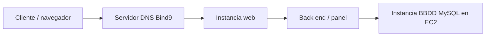

# RG502: Integración y seguridad en AWS

**Resultado de Aprendizaje:** RA3  
**Puntuación total:** 30 puntos  
**Trabajo en grupo:** 2-3 personas

---

## Contexto y continuidad

Este reto es la continuación del despliegue realizado en el tema 4. En el proyecto basado en instancias AWS debéis:

- integrar extremo a extremo web/back end,
- reforzar seguridad con reglas de red y validaciones,
- y además **separar la base de datos** en una **instancia EC2 nueva** que ejecute **MySQL** (en vez de depender de RDS por coste).

Diseño de referencia (proyecto AWS):  

[Un proyecto de un curso anterior](https://alejandromarinyo.github.io/Proyecto-Intermodular/Dise%C3%B1o_y_Planificacion/)

Este reto incorpora como base conceptual los pasos de:

- `PR403` (DNS con Bind9, zonas directa/inversa y comprobaciones con `nslookup`).

  [PR403 - Configuración de un servidor DNS (Bind9) en AWS](PR403_Configuracion_Servidor_DNS.md)

Además, adapta la idea de “crear la BBDD y asegurar el acceso” desde un enfoque de seguridad de grupos e integración desde la aplicación, pero **sin** mencionar tecnologías de desarrollo concretas (ni Spring Boot): aquí el objetivo es el flujo de conexión del proyecto hacia MySQL.

---

## Punto de partida (comprobación del estado real del proyecto)

Según el desarrollo publicado del proyecto (fase “Desarrollo”), el despliegue base ya contempla:

- **2 instancias EC2** separadas:
  - Instancia 1: **WordPress**.
  - Instancia 2: **aplicación web personalizada**.
- **Security Groups** por instancia con puertos web abiertos (80 y 443 “preparado”) y SSH para administración.
- **Elastic IP** asociada a cada instancia.
- **Docker Compose** en cada servidor:
  - En el servidor WordPress: WordPress + MySQL (y opcionalmente phpMyAdmin).
  - En el servidor de la app: servicio web + MySQL 8.0.

Referencia de estado (para comprobar el punto de partida):  

[Un proyecto de un curso anterior](https://alejandromarinyo.github.io/Proyecto-Intermodular/Desarrollo/)

Este reto no debe repetir el despliegue básico anterior: el foco está en **integración**, **separación de BBDD** (si aún no existe) y **seguridad en AWS con evidencias**.

---

## Objetivo

1. Implementar un DNS (Bind9) que permita validar nombres hacia el servidor web (opcional si el proyecto ya usa dominio/DNS público: en ese caso, se hace como práctica técnica interna).
2. Crear una nueva instancia EC2 para BBDD con **MySQL** y configurar:

    - Security Groups para permitir `3306` **solo** desde las instancias que deben acceder,
    - base de datos/usuarios,
    - y la conexión desde el resto de instancias del proyecto.
3. Añadir **tareas de seguridad en AWS** (red, acceso, logging, backups y cifrado) y validarlas con evidencias.
4. Validar integración y persistencia con evidencias.

---

## Tareas (resumen)

| # | Tarea | Guía |
|---|------|------|
| 1 | DNS con Bind9 (tipo `PR403`) | [Guía 1](#guia-1-integracion-dns-con-bind9-continuacion-de-pr403) |
| 2 | Nueva EC2 “DB” con MySQL (sin RDS) | [Guía 2](#guia-2-instancia-nueva-de-bbdd-en-ec2-con-mysql-sin-rds) |
| 3 | Conexión desde web/app hacia MySQL | [Guía 3](#guia-3-conectar-web-y-back-end-hacia-el-nuevo-mysql) |
| 4 | Validación integración + pruebas negativas | [Guía 4](#guia-4-validacion-de-integracion-y-seguridad) |
| 5 | Seguridad AWS (red y exposición mínima) | [Guía 5](#guia-5-seguridad-aws-red-y-exposicion-minima) |
| 6 | Seguridad AWS (acceso e IAM) | [Guía 6](#guia-6-seguridad-aws-acceso-e-iam) |
| 7 | Seguridad AWS (logs, alertas y visibilidad) | [Guía 7](#guia-7-seguridad-aws-logs-alertas-y-visibilidad) |
| 8 | Seguridad AWS (backups, recuperación y cifrado) | [Guía 8](#guia-8-seguridad-aws-backups-recuperacion-y-cifrado) |

---

## Guía 1: Integración DNS con Bind9 (continuación de `PR403`)

**Objetivo:** que un nombre del proyecto resuelva hacia la IP del servidor web y que se valide con `nslookup` y navegación (sin depender de `/etc/hosts`).

!!! note "Si ya tenéis dominio público"
    Si el proyecto ya usa Route 53 u otro DNS público, esta guía se puede aplicar como **DNS interno de laboratorio** (Bind9) para demostrar competencia técnica y control de resolución en una VPC.

1. **Crear instancia EC2 para DNS**

    - Imagen: **Debian** (como en `PR403`).
    - Security Group: permitir SSH (`22`) a vuestra IP y DNS (`UDP/53`) desde la red que vayáis a consultar (recomendado: VPC).

2. **Instalar Bind9**

    ```bash
    sudo apt update
    sudo apt-get install bind9 bind9utils bind9-doc -y
    ```

3. **Configurar IPv4 únicamente en `/etc/default/named`**

    - Abrir y editar el fichero (por ejemplo): `sudo nano /etc/default/named`.
    - Asegurar la línea: `OPTIONS="-u bind -4"`.

4. **Backup de `named.conf.options`**

    ```bash
    sudo cp /etc/bind/named.conf.options /etc/bind/named.conf.options.backup
    ```

5. **Editar `named.conf.options`** (`/etc/bind/named.conf.options`)

    - Configurar ACL de recursión (ejemplo): permite recursión desde vuestra VPC (`<VPC_CIDR>`).
    - En el bloque `options` incluir (ajusta rangos): `allow-recursion { <VPC_CIDR>; };`, `listen-on port 53 { any; };`, y el directorio de caché.

6. **Configurar `named.conf.local`** (`/etc/bind/named.conf.local`)

    - Declarar **zona directa** (ej. `creviplay.local`) apuntando a la IP del servidor web.
    - Declarar **zona inversa** según vuestro rango (ej. si la red es `172.31.0.0/16`, la inversa sería `31.172.in-addr.arpa`).

7. **Crear archivos de zona**

    - Zona directa: por ejemplo `/etc/bind/db.creviplay.local` (SOA, NS y un registro A hacia la IP del servidor web).
    - Zona inversa: por ejemplo `/etc/bind/db.31.172` (PTR para la IP que validéis).

8. **Comprobar configuración**

    ```bash
    named-checkconf
    named-checkzone <NOMBRE_ZONA_DIRECTA> /etc/bind/db.creviplay.local
    named-checkzone <NOMBRE_ZONA_INVERSA> /etc/bind/db.31.172
    ```

9. **Reiniciar Bind9**

    ```bash
    sudo systemctl restart bind9
    ```

10. **Validar con cliente**

    - Desde un cliente (otra EC2 o vuestro PC), evitad `/etc/hosts` y configurad como DNS la IP del servidor Bind9 (`IP_DNS`).
    - Comprobar con `nslookup creviplay.local <IP_DNS>` (o el nombre que hayáis definido).
    - Abrir en navegador `http://creviplay.local` (o el nombre y puerto que corresponda).

**Mermaid (flujo DNS + integración):**



**Evidencias mínimas (Guía 1):**

- `named-checkconf` y `named-checkzone` OK.
- `nslookup <nombre> <IP_DNS>` resolviendo correctamente.
- Captura de navegación usando el nombre (no IP).

---

## Guía 2: Instancia nueva de BBDD en EC2 con MySQL (sin RDS)

**Objetivo:** disponer de una BBDD gestionada por el equipo en una EC2 dedicada, con acceso restringido por Security Group (sin RDS).

1. **Crear instancia EC2 “DB”**

    - OS: Debian/Ubuntu (similar a `PR403` para mantener continuidad).
    - Instancia en subred que permita comunicación con web/back end (ideal: privada).

2. **Security Groups (seguridad primero)**

    - Inbound: permitir `TCP/3306` **solo** desde los Security Groups de la instancia web y del back end.
    - No abrir `3306` a `0.0.0.0/0`.

3. **Instalar MySQL**

    ```bash
    sudo apt update
    sudo apt install mysql-server -y
    sudo systemctl enable --now mysql
    ```

4. **Crear base de datos y usuario**

    Conectar como root:

    ```bash
    sudo mysql
    ```

    Crear schema y usuario (ajusta nombres):

    ```sql
    CREATE DATABASE creviplay CHARACTER SET utf8mb4 COLLATE utf8mb4_unicode_ci;
    CREATE USER 'creviplay_app'@'%' IDENTIFIED BY '<PASSWORD_SEGURA>';
    GRANT ALL PRIVILEGES ON creviplay.* TO 'creviplay_app'@'%';
    FLUSH PRIVILEGES;
    ```

5. **Configurar escucha de MySQL**

    - Asegurar que MySQL escucha en la interfaz privada para que web/back end puedan conectar.
    - En `/etc/mysql/mysql.conf.d/mysqld.cnf` (o equivalente): `bind-address = <IP_PRIVADA_DB>`.

6. **Backup y persistencia**

    - Reiniciar MySQL o la instancia y comprobar que los datos siguen.
    - Documentar snapshots EBS (si tenéis acceso) o backup con `mysqldump`.

**Evidencias mínimas (Guía 2):**

- Captura/config del SG de la instancia DB mostrando `3306` solo desde SGs concretos.
- `systemctl status mysql` en verde.
- `ss -lntp | grep 3306` mostrando escucha en IP privada o `0.0.0.0` según decisión (justificar).

---

## Guía 3: Conectar web y back end hacia el nuevo MySQL

**Objetivo:** que las instancias/servicios de la solución conecten a la nueva DB por **IP privada** y con credenciales de aplicación.

1. **Actualizar configuración del proyecto**

    - Sustituir el antiguo `DB_HOST` (por ejemplo RDS) por `DB_HOST = <IP_PRIVADA_DB>` (o hostname interno).
    - Actualizar `DB_USER`, `DB_PASSWORD` y `DB_NAME` para el usuario creado en MySQL.

2. **Si usáis contenedores**

    - Actualizar `wp-config.php` / variables de entorno dentro de los contenedores.
    - Comprobar que el host/IP se resuelve y es accesible desde esa capa.

3. **Prueba de conectividad (obligatorio)**

    Desde web o back end:

    ```bash
    mysql -h <IP_PRIVADA_DB> -u creviplay_app -p -e "SELECT 1;"
    ```

    Si no tenéis cliente MySQL, ejecutadlo desde el contenedor o instalad `mysql-client` (según corresponda).

**Evidencias mínimas (Guía 3):**

- `SELECT 1` correcto desde la(s) instancia(s) autorizada(s).
- Captura del fichero/variables donde se ve `DB_HOST=<IP_PRIVADA_DB>` (ocultando contraseñas).

---

## Guía 4: Validación de integración y seguridad

**Objetivo:** demostrar integración extremo a extremo, y que la seguridad de red funciona con una prueba negativa.

- **Integración:** web accesible; el back end realiza una operación real sobre datos.

- **Sustitución “sin RDS”:** demostrar que el flujo apunta a MySQL de la instancia nueva (con `SELECT` o evidencias de configuración).

- **Seguridad (validación):** evidencia de reglas del SG de MySQL (origen restringido) y prueba negativa desde una instancia/SG no autorizado (debe fallar la conexión a `3306`).

---

## Guía 5: Seguridad AWS (red y exposición mínima)

**Objetivo:** reducir superficie de ataque y demostrar que solo están abiertos los puertos imprescindibles.

1. **Auditar puertos en Security Groups**

    - SSH (`22`) solo desde vuestra IP (o red del centro).
    - HTTP (`80`) y/o HTTPS (`443`) solo donde corresponda (servidores web).
    - MySQL (`3306`) solo entre SGs (nunca `0.0.0.0/0`).

2. **Separación por roles**

    - SG “WEB” (80/443) para instancias web.
    - SG “DB” (3306 solo desde SG WEB/APP).

3. **Prueba negativa**

    Desde una EC2 “no autorizada” (otro SG), ejecutar:

    ```bash
    nc -vz <IP_PRIVADA_DB> 3306
    ```

    Debe fallar (timeout/denied).

**Evidencias mínimas (Guía 5):**

- Capturas de reglas SG antes/después (o tabla en documentación).
- `nc`/`telnet` fallando desde origen no autorizado y `mysql` funcionando desde origen autorizado.

---

## Guía 6: Seguridad AWS (acceso e IAM)

**Objetivo:** controlar cómo se administra AWS y cómo se accede por SSH, reduciendo riesgos.

1. **IAM (mínimo)**

    - Usar usuarios IAM (no root) y MFA activado.
    - Documentar qué usuario/rol usáis y por qué permisos mínimos.

2. **Acceso SSH**

    - Claves SSH (sin contraseñas).
    - En `/etc/ssh/sshd_config`: `PasswordAuthentication no` y `PermitRootLogin no`.
    - Recargar SSH: `sudo systemctl reload ssh` (o `sshd` según distro).

3. **Rotación básica**

    - Cambiar el par de claves si se comparte entre equipo, o documentar el procedimiento.

**Evidencias mínimas (Guía 6):**

- Captura de SG con `22` restringido.
- Extracto de `sshd_config` con las 2 directivas (sin mostrar datos sensibles).
- Captura IAM/MFA o checklist firmado por el equipo.

---

## Guía 7: Seguridad AWS (logs, alertas y visibilidad)

**Objetivo:** tener trazabilidad y avisos básicos ante problemas o accesos.

1. **CloudWatch (mínimo)**

    - Activar métricas/alarma para CPU alta sostenida, disco (si aplica) y estado de instancia.

2. **Logs del sistema**

    - Documentar dónde se ven logs de Nginx/Apache, aplicación y MySQL.
    - (Opcional) instalar/activar CloudWatch Agent para enviar logs.

3. **Evidencia de evento**

    - Forzar un evento “controlado” (ej. pico CPU con `stress`, o reinicio de servicio) y mostrar métrica, alarma o log.

**Evidencias mínimas (Guía 7):**

- Captura de una alarma en CloudWatch (configuración) y de la métrica.
- Captura de logs de acceso web y de error (un ejemplo).

---

## Guía 8: Seguridad AWS (backups, recuperación y cifrado)

**Objetivo:** demostrar recuperación ante fallo y uso de cifrado donde aplique.

1. **Backups**

    - MySQL: `mysqldump` (o backup lógico equivalente) guardado fuera del contenedor/servicio.
    - EC2: snapshots EBS (si está permitido) o plan documentado.

2. **Prueba de restauración**

    - Crear un registro “TEST_BACKUP”, borrarlo, restaurar desde backup y evidenciar que vuelve.

3. **Cifrado**

    - Verificar y documentar si el volumen EBS está cifrado (por defecto o KMS).
    - Documentar cifrado en tránsito (HTTPS en 443) si aplica.

**Evidencias mínimas (Guía 8):**

- Evidencia del backup y restore (comandos + resultado).
- Captura del snapshot (si aplica) o del plan.
- Captura/validación de cifrado (EBS y/o HTTPS).

---

## Entregables

1. Evidencia DNS:

    - Archivos de configuración de Bind9.
    - Resultados de `named-checkconf` / `named-checkzone`.
    - Capturas de `nslookup` y acceso por navegador.

2. Evidencia BBDD en EC2 (MySQL):

    - Configuración/instalación (resumen).
    - Reglas del Security Group de MySQL (origen restringido).
    - Pruebas de conexión desde web/back end.

3. Evidencia de integración:

    - Capturas del sitio web.
    - Capturas o logs del back end realizando operaciones con datos reales.

4. Documentación:

    - Cambios aplicados.
    - Problemas/dificultades encontradas y cómo se resolvieron.

5. Evidencia de seguridad en AWS:

    - Auditoría de puertos/SG.
    - Prueba negativa de acceso a `3306`.
    - IAM/MFA y hardening SSH.
    - Al menos una alarma o log relevante en CloudWatch.

---

## Criterios de evaluación (30p)

- DNS configurado y validado correctamente (8p)

- BBDD MySQL en EC2 nueva: instalación, seguridad y conexión (10p)

- Seguridad AWS (SG/IAM/logs/backups) con evidencias (8p)

- Integración extremo a extremo (web/back end -> BBDD) con evidencias (3p)

- Documentación y calidad de evidencias (1p)

